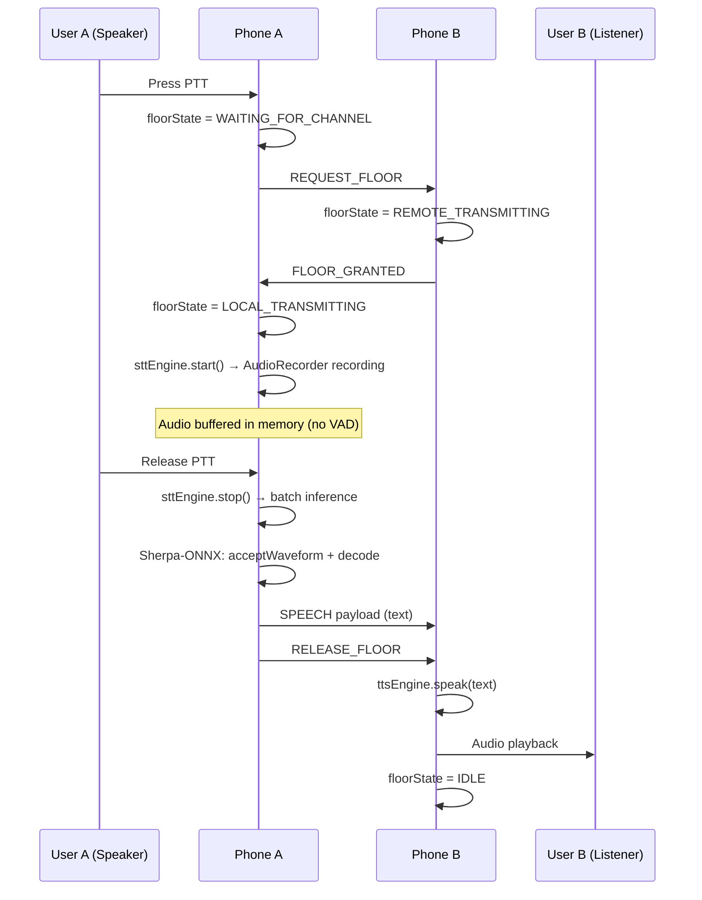
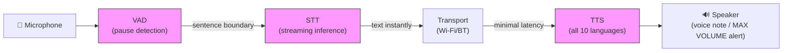
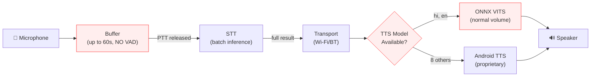
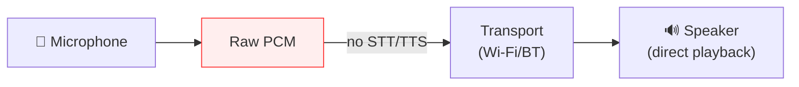

# ANALYSIS AGAINST SIH PROBLEM STATEMENT

## Forensic Compliance Audit — iTantra POC vs. SIH Requirements

> **Audit Date:** September 2026  
> **Evidence Standard:** Every [FACT] cites exact file, class, function, and line numbers from the repository.  
> **Methodology:** Static code analysis, dependency inspection, model configuration review, data flow tracing.

---

## Table of Contents

1. [SIH Problem Statement (Verbatim)](#1-sih-problem-statement-verbatim)
2. [Decomposed Requirements](#2-decomposed-requirements)
3. [Requirement Traceability Matrix](#3-requirement-traceability-matrix)
4. [REQ-01: Android App](#4-req-01-android-app)
5. [REQ-02: Lightweight, Highly Accurate STT Models](#5-req-02-lightweight-highly-accurate-stt-models)
6. [REQ-03: Lightweight, Highly Accurate TTS Models](#6-req-03-lightweight-highly-accurate-tts-models)
7. [REQ-04: 10 Indian Languages](#7-req-04-10-indian-languages)
8. [REQ-05: Runs Locally on a Low-Power Device](#8-req-05-runs-locally-on-a-low-power-device)
9. [REQ-06: STT Detects Pauses and Stoppages](#9-req-06-stt-detects-pauses-and-stoppages)
10. [REQ-07: Form Sentences and Stream Instantly](#10-req-07-form-sentences-and-stream-instantly)
11. [REQ-08: Wi-Fi Connectivity](#11-req-08-wi-fi-connectivity)
12. [REQ-09: Bluetooth Connectivity](#12-req-09-bluetooth-connectivity)
13. [REQ-10: TTS Voice Note Playback](#13-req-10-tts-voice-note-playback)
14. [REQ-11: Alert at Highest Volume](#14-req-11-alert-at-highest-volume)
15. [REQ-12: Non-Interruptible Alerts](#15-req-12-non-interruptible-alerts)
16. [REQ-13: Walkie-Talkie Mode (PTT)](#16-req-13-walkie-talkie-mode-ptt)
17. [REQ-14: Phone Mode](#17-req-14-phone-mode)
18. [REQ-15: Offline Operation](#18-req-15-offline-operation)
19. [REQ-16: Open-Source Models](#19-req-16-open-source-models)
20. [Performance Metrics Assessment](#20-performance-metrics-assessment)
21. [Critical Gaps Summary](#21-critical-gaps-summary)
22. [High Gaps Summary](#22-high-gaps-summary)
23. [Medium Gaps Summary](#23-medium-gaps-summary)
24. [Architectural Flow Diagram vs. Requirements](#24-architectural-flow-diagram-vs-requirements)
25. [Recommendations](#25-recommendations)

---

## 1. SIH Problem Statement (Verbatim)

> "Build an Android App with lightweight, highly accurate STT and TTS models for 10 Indian Languages (Hindi, Gujarati, Marathi, Kannada, Malayalam, Tamil, Telugu, Odia, Bengali, English) that runs locally on a low-power device. The system's STT module when activated after detecting pauses and stoppages should form the sentences detected and must instantly and efficiently stream the data through wifi/Bluetooth connected embedded device or another phone with same application with minimal latency. The systems TTS module when activated after receiving the Text data should convert it into intelligible speech which will be played as a voice note and alert type messages will be announced at highest volume non-interruptible. To verify the complete loop two phones with same app one in TTS mode and another in STT mode can be connected via wifi or Bluetooth and it should work like a walkie talkie using push to talk feature, if turned off it should work like a phone."

---

## 2. Decomposed Requirements

The problem statement is decomposed into 16 auditable requirements:

| ID | Extracted Requirement | Priority |
|----|----------------------|----------|
| REQ-01 | Build an Android App | Mandatory |
| REQ-02 | Lightweight, highly accurate STT models | Mandatory |
| REQ-03 | Lightweight, highly accurate TTS models | Mandatory |
| REQ-04 | Support 10 Indian Languages (specified list) | Mandatory |
| REQ-05 | Runs locally on a low-power device | Mandatory |
| REQ-06 | STT detects pauses and stoppages | Mandatory |
| REQ-07 | Form sentences and stream data instantly with minimal latency | Mandatory |
| REQ-08 | Wi-Fi connectivity | Mandatory |
| REQ-09 | Bluetooth connectivity | Mandatory |
| REQ-10 | TTS plays as voice note | Mandatory |
| REQ-11 | Alert messages announced at highest volume | Mandatory |
| REQ-12 | Alert messages are non-interruptible | Mandatory |
| REQ-13 | Walkie-talkie mode with push-to-talk | Mandatory |
| REQ-14 | Phone mode when PTT turned off | Mandatory |
| REQ-15 | Offline operation (implicit: "runs locally") | Mandatory |
| REQ-16 | Open-source models (implicit: "lightweight" + "accurate" implies custom, not proprietary) | High |

---

## 3. Requirement Traceability Matrix

| Req ID | Requirement | Verdict | Confidence | Key Evidence |
|--------|------------|---------|------------|--------------|
| REQ-01 | Android App | ✅ **IMPLEMENTED** | High | Standard Android project with Jetpack Compose |
| REQ-02 | Lightweight accurate STT | ⚠️ **PARTIALLY IMPLEMENTED** | Medium | STT works but no accuracy metrics exist |
| REQ-03 | Lightweight accurate TTS | ⚠️ **PARTIALLY IMPLEMENTED** | Low | Only 2/10 languages have local models |
| REQ-04 | 10 Indian Languages | ❌ **NOT MET** | High | Odia missing entirely; 8 languages lack local TTS |
| REQ-05 | Low-power device | ⚠️ **PARTIALLY IMPLEMENTED** | Low | arm64-v8a only; no benchmarks; no NNAPI |
| REQ-06 | STT detects pauses | ❌ **NOT IMPLEMENTED** | High | VAD exists but not wired to production STT |
| REQ-07 | Instant streaming | ❌ **NOT IMPLEMENTED** | High | Batch-only STT; entire recording processed after stop |
| REQ-08 | Wi-Fi connectivity | ✅ **IMPLEMENTED** | High | Wi-Fi Direct fully functional |
| REQ-09 | Bluetooth connectivity | ✅ **IMPLEMENTED** | High | Bluetooth RFCOMM fully functional |
| REQ-10 | TTS voice note | ✅ **IMPLEMENTED** | High | AudioPlayer plays generated speech |
| REQ-11 | Alert highest volume | ❌ **BROKEN** | High | Primary TTS path ignores volume; only fallback works |
| REQ-12 | Alert non-interruptible | ❌ **BROKEN** | High | Primary TTS path has no AudioFocus management |
| REQ-13 | Walkie-talkie PTT | ✅ **IMPLEMENTED** | High | Floor control state machine + gesture detection |
| REQ-14 | Phone mode | ⚠️ **PARTIALLY IMPLEMENTED** | Medium | Implemented as raw PCM, not AI-processed |
| REQ-15 | Offline operation | ❌ **VIOLATED** | High | Models downloaded from internet on first use |
| REQ-16 | Open-source models | ⚠️ **PARTIALLY MET** | Medium | Core models OSS; Android TTS fallback is proprietary |

**Summary:** 5 of 16 requirements fully met. 5 partially met. 6 not met or broken.

---

## 4. REQ-01: Android App

**Verdict: ✅ IMPLEMENTED**

**Evidence:**
- [FACT] Standard Android project structure with `build.gradle.kts`, `AndroidManifest.xml`, Jetpack Compose UI.
- [FACT] `compileSdk = 35`, `targetSdk = 35`, `minSdk = 24` — `build.gradle.kts`.
- [FACT] Application class: `iTantraApplication.kt` (L29).
- [FACT] Material 3 theme, multi-screen navigation (`MainNavGraph.kt`).

**Assessment:** Fully satisfies the "Android App" requirement.

---

## 5. REQ-02: Lightweight, Highly Accurate STT Models

**Verdict: ⚠️ PARTIALLY IMPLEMENTED**

### 5.1 What IS Implemented

- [FACT] Production STT engine: `IndicConformerSttEngine.kt` (222 lines).
- [FACT] Uses Sherpa-ONNX `OfflineRecognizer` with `OfflineNemoEncDecCtcModelConfig` — `ModelManager.kt` L193.
- [FACT] Models are INT8 quantized: filename `model.int8.onnx` — `ModelConfig.kt` L20.
- [FACT] Decoding: `greedy_search` — `ModelManager.kt` L198.
- [FACT] Inference threads: `numThreads = 2` — `ModelManager.kt` L47.

### 5.2 What is MISSING

| Missing Item | Impact |
|-------------|--------|
| **No WER (Word Error Rate) measurements** | Cannot verify "highly accurate" claim |
| **No RTF (Real-Time Factor) measurements** | Cannot verify "lightweight" claim |
| **No model size measurements documented** | Cannot verify "lightweight" claim |
| **No benchmark code** | No reproducible performance evidence |
| **No comparison against baselines** | No way to assess relative quality |

### 5.3 Assessment

The STT model exists and can perform inference. However, the claim of "highly accurate" is completely unsubstantiated — there are zero accuracy measurements anywhere in the repository. The claim of "lightweight" is unverified — no model sizes, memory usage, or CPU benchmarks are documented.

---

## 6. REQ-03: Lightweight, Highly Accurate TTS Models

**Verdict: ⚠️ PARTIALLY IMPLEMENTED**

### 6.1 What IS Implemented

- [FACT] Production TTS engine: `IndicParlerTtsEngine.kt`.
- [FACT] Uses Sherpa-ONNX `OfflineTts` with `OfflineTtsVitsModelConfig` — `ModelManager.kt` L305.
- [FACT] Hindi TTS: `vits-piper-hi_IN-pratham-medium.onnx` — `ModelConfig.kt` L22.
- [FACT] English TTS: `vits-mms-eng/model.onnx` — `ModelConfig.kt` L101.

### 6.2 What is MISSING

| Missing Item | Impact |
|-------------|--------|
| **TTS models for 8 languages** | Bengali, Tamil, Telugu, Marathi, Gujarati, Kannada, Malayalam, Odia have `ttsModelUrl = null` |
| **No MOS (Mean Opinion Score)** | Cannot verify "intelligible speech" claim |
| **No latency measurements** | Cannot verify TTS generation speed |
| **Fallback to proprietary engine** | 8 languages use Android built-in TTS (not open-source) |

### 6.3 Fallback Mechanism Detail

When `ttsModelUrl == null`, `ModelManager.loadTtsModel()` returns `null` — `ModelManager.kt` L268-273:

```kotlin
if (config.ttsModelUrl == null) {
    val msg = "TTS not available for $lang"
    Log.w(TAG, msg)
    _ttsState.value = ModelState.Error(msg)
    return@withLock null
}
```

`IndicParlerTtsEngine` then falls back to `MockTtsEngine` which wraps Android's built-in `TextToSpeech` API. This means for 8 of 10 languages, TTS quality depends entirely on the device manufacturer's TTS implementation, which:
- May not support the language at all
- Is NOT open-source
- Varies dramatically by OEM and Android version
- May require Google Play Services

---

## 7. REQ-04: 10 Indian Languages

**Verdict: ❌ NOT MET**

### 7.1 Complete Language Compliance Matrix

| # | Language | Code | STT Model | STT Functional | TTS Model | TTS Functional | Overall |
|---|----------|------|-----------|---------------|-----------|---------------|---------|
| 1 | Hindi | `hi` | ✅ URL defined | ✅ Yes | ✅ Piper VITS | ✅ Yes | ✅ Full |
| 2 | Gujarati | `gu` | ✅ URL defined | ✅ Yes | ❌ `null` | ⚠️ Fallback | ⚠️ Partial |
| 3 | Marathi | `mr` | ✅ URL defined | ✅ Yes | ❌ `null` | ⚠️ Fallback | ⚠️ Partial |
| 4 | Kannada | `kn` | ✅ URL defined | ✅ Yes | ❌ `null` | ⚠️ Fallback | ⚠️ Partial |
| 5 | Malayalam | `ml` | ✅ URL defined | ✅ Yes | ❌ `null` | ⚠️ Fallback | ⚠️ Partial |
| 6 | Tamil | `ta` | ✅ URL defined | ✅ Yes | ❌ `null` | ⚠️ Fallback | ⚠️ Partial |
| 7 | Telugu | `te` | ✅ URL defined | ✅ Yes | ❌ `null` | ⚠️ Fallback | ⚠️ Partial |
| 8 | Odia | `or` | ❌ Empty URLs | ❌ No | ❌ `null` | ❌ No | ❌ Missing |
| 9 | Bengali | `bn` | ✅ URL defined | ✅ Yes | ❌ `null` | ⚠️ Fallback | ⚠️ Partial |
| 10 | English | `en` | ✅ URL defined | ✅ Yes | ✅ MMS VITS | ✅ Yes | ✅ Full |

**Evidence:**
- [FACT] `ModelConfig.kt` L81-87: Odia config has `sttModelUrl = ""`, `sttTokensUrl = ""`, `available = false`, display name `"Odia (Coming Soon)"`.
- [FACT] `ModelConfig.kt` L88-95: Assamese (`as`) is defined but NOT in the `SupportedLanguage.kt` enum — it cannot be selected by users.
- [FACT] `SupportedLanguage.kt` explicitly notes: "Punjabi is NOT in SIH spec — deliberately omitted."

### 7.2 Assessment

- **2 of 10** languages have complete STT + TTS coverage (Hindi, English).
- **7 of 10** languages have STT but no local TTS (fall back to proprietary Android TTS).
- **1 of 10** languages (Odia) is completely non-functional.
- The "10 Indian Languages" requirement is **not met**.

---

## 8. REQ-05: Runs Locally on a Low-Power Device

**Verdict: ⚠️ PARTIALLY IMPLEMENTED**

### 8.1 What IS Implemented

- [FACT] All inference runs on-device via Sherpa-ONNX (CPU provider) — `ModelManager.kt` L196, L311.
- [FACT] Models use INT8 quantization — `ModelConfig.kt` filename `model.int8.onnx`.
- [FACT] `numThreads = 2` — `ModelManager.kt` L47.

### 8.2 What is MISSING or Concerning

| Concern | Detail | Evidence |
|---------|--------|----------|
| **arm64-v8a only** | 32-bit ARM devices unsupported | `build.gradle.kts` `ndk.abiFilters` |
| **49MB native AAR** | `sherpa-onnx-1.13.7.aar` adds significant APK size | `app/libs/` |
| **No NNAPI/GPU/NPU** | `provider = "cpu"` hardcoded, no hardware acceleration | `ModelManager.kt` L196, L311 |
| **No performance benchmarks** | Zero CPU, RAM, battery measurements | Entire repository searched |
| **60s audio buffer** | MAX_CAPTURE_SAMPLES = 960,000 floats = ~3.66 MB per PTT | `IndicConformerSttEngine.kt` L16 |
| **No model compression stats** | No data on model file sizes or memory footprint | Entire repository |

### 8.3 Assessment

The application CAN run locally, but there is zero evidence it runs well on "low-power" devices. The exclusive arm64-v8a support, the 49MB AAR, and the lack of any performance data make this claim unverifiable. A "low-power device" typically implies budget phones which may have limited RAM — the 60-second audio buffer (3.66 MB) plus loaded ONNX models could be problematic.

---

## 9. REQ-06: STT Detects Pauses and Stoppages

**Verdict: ❌ NOT IMPLEMENTED (in production)**

### 9.1 SIH Requirement (Exact Quote)
> "The system's STT module when activated **after detecting pauses and stoppages** should form the sentences detected"

### 9.2 Evidence

**VAD Components Exist:**
- [FACT] `SileroVadEngine.kt` (245 lines): Real Silero VAD v4/v5 ONNX model, 512-sample (32ms) frame processing, with energy-based fallback.
- [FACT] `SpeechSegmenter.kt` (84 lines): Debouncing state machine with `SPEECH_START`, `SPEECH_END` events.
- [FACT] `silero_vad.onnx` bundled in `app/src/main/assets/` (~2.3 MB).

**VAD is NOT Connected to Production:**
- [FACT] `IndicConformerSttEngine.kt` does NOT import, reference, or use `SileroVadEngine` or `SpeechSegmenter`. Search of the file confirms zero references.
- [FACT] `MockSttEngine.kt` L58-61: VAD parameters are configured here. L186, L208: Frame processing and segmenter events handled here.
- [FACT] `iTantraApplication.kt` L56-57: Production instantiates `IndicConformerSttEngine`, NOT `MockSttEngine`.

**What Actually Happens:**
1. User presses PTT → `sttEngine.start()` → `AudioRecorder` starts recording
2. Audio chunks are blindly accumulated in memory (no analysis)
3. User releases PTT → `sttEngine.stop()` → all accumulated audio is batch-processed

**There is NO automatic pause detection. There is NO sentence segmentation. The STT processes audio ONLY when manually triggered to stop.**

### 9.3 The Irony

The `MockSttEngine` (L29-226) contains a production-quality VAD pipeline that perfectly implements this requirement — but it emits placeholder text (`"[sim-stt segment #$seqId, lang=$languageCode]"` — L186, L208) instead of running actual inference. The production engine runs real inference but has no VAD. The two halves of the solution exist in separate classes but are never combined.

---

## 10. REQ-07: Form Sentences and Stream Instantly

**Verdict: ❌ NOT IMPLEMENTED**

### 10.1 SIH Requirement (Exact Quote)
> "should form the sentences detected and must **instantly and efficiently stream the data** through wifi/Bluetooth... with **minimal latency**"

### 10.2 Evidence

**No Streaming:**
- [FACT] `IndicConformerSttEngine.kt` L125-140: All audio chunks are concatenated into a single `FloatArray` after `stop()`.
- [FACT] `IndicConformerSttEngine.kt` L171-175: Inference is a single `acceptWaveform` + `decode` call on the complete segment.
- [FACT] There is no partial/intermediate result emission during recording.

**Latency Implications:**
- A 10-second PTT press generates 160,000 samples (at 16kHz).
- These are ALL buffered in memory, then processed in ONE batch after release.
- The user must wait for full STT inference to complete before any text is transmitted.
- No partial transcripts are sent during speech.

**What "Instant Streaming" Would Require:**
1. VAD-driven chunking: detect speech segments in real-time
2. Partial inference: process each chunk as it's detected
3. Incremental transmission: send partial results as they become available

**None of these are implemented in the production path.**

### 10.3 Latency Debug Panel

- [FACT] `SessionScreen.kt` L609-611: UI has latency color-coding (<100ms green, <500ms amber, else red).
- [FACT] `TranscriptEntry.kt` tracks: `micPauseDetectedMs`, `sttCompleteMs`, `sentMs`, `receivedMs`, `ttsStartedMs`.
- However, **no latency measurements are recorded, stored, or reported** anywhere in the repository.

---

## 11. REQ-08: Wi-Fi Connectivity

**Verdict: ✅ IMPLEMENTED**

### 11.1 Evidence

- [FACT] `WifiDirectSocketTransport.kt` (~300 lines): Complete Wi-Fi Direct implementation.
- [FACT] Uses `WifiP2pManager` for peer discovery, connection, and group formation.
- [FACT] TCP socket server on port `8988`.
- [FACT] Server/client role based on `isGroupOwner` property from `WifiP2pInfo`.
- [FACT] Discovery mechanism: `discoverPeers()` → `WIFI_P2P_PEERS_CHANGED_ACTION` → `requestPeers()`.
- [FACT] Connection: `connect(WifiP2pConfig)` → `WIFI_P2P_CONNECTION_CHANGED_ACTION` → `requestConnectionInfo()`.

### 11.2 Note

This is **Wi-Fi Direct** (peer-to-peer), NOT Wi-Fi through a router. The SIH says "wifi" without specifying which type. Wi-Fi Direct is arguably more appropriate for the use case as it doesn't require infrastructure.

---

## 12. REQ-09: Bluetooth Connectivity

**Verdict: ✅ IMPLEMENTED**

### 12.1 Evidence

- [FACT] `BluetoothSocketTransport.kt` (~280 lines): Complete Bluetooth Classic RFCOMM implementation.
- [FACT] SPP UUID: `00001101-0000-1000-8000-00805F9B34FB`.
- [FACT] Discovers bonded devices and initiates RFCOMM connections.
- [FACT] Server/client role tie-breaking via MAC address comparison (lower MAC → server).
- [FACT] Server: `BluetoothServerSocket.accept(timeout = 30_000ms)`.
- [FACT] Client: Retry loop with `1000ms` delay, up to `3` retries.

### 12.2 Documentation Discrepancy

**[FACT]** The project README claims Bluetooth is a "stub" with "Zero active BT logic currently." This is **FALSE**. The Bluetooth transport is fully implemented and is actually the **default transport** selected in `iTantraApplication.kt` L44-47.

---

## 13. REQ-10: TTS Voice Note Playback

**Verdict: ✅ IMPLEMENTED**

### 13.1 Evidence

- [FACT] `IndicParlerTtsEngine.kt`: Generates audio via Sherpa-ONNX VITS model.
- [FACT] `AudioPlayer.kt`: Plays generated PCM audio via `AudioTrack`.
- [FACT] `SessionController.kt` L594: On receiving speech payload, calls `ttsEngine.speak(sentence)`.
- [FACT] Generated audio plays as a voice note to the user.

### 13.2 Caveat

TTS is batch-generated — the entire sentence is synthesized before playback begins. There is no streaming/chunked playback. This adds latency for longer sentences but the voice note functionality is present.

---

## 14. REQ-11: Alert at Highest Volume

**Verdict: ❌ BROKEN**

### 14.1 SIH Requirement (Exact Quote)
> "alert type messages will be announced at **highest volume**"

### 14.2 Evidence

**Primary TTS Path (IndicParlerTtsEngine + AudioPlayer):**
- [FACT] `AudioPlayer.kt`: Sets `USAGE_ALARM` on the `AudioTrack`.
- [FACT] **NEVER** calls `AudioManager.setStreamVolume(STREAM_ALARM, maxVolume, 0)`.
- [FACT] **NEVER** interacts with `AudioManager` at all for volume control.
- **Result:** Alerts play at whatever volume the user's device is currently set to.

**Fallback TTS Path (MockTtsEngine):**
- [FACT] `MockTtsEngine.kt`: On `isAlert = true`:
  - Saves current `STREAM_ALARM` volume
  - Sets to maximum: `audioManager.setStreamVolume(STREAM_ALARM, maxVol, 0)`
  - Requests `AUDIOFOCUS_GAIN_TRANSIENT_EXCLUSIVE`
  - After completion: restores previous volume

### 14.3 When Each Path is Used

| Language | TTS Engine Used | Alert Volume Correct? |
|----------|----------------|----------------------|
| Hindi | IndicParlerTtsEngine (ONNX) | ❌ No — plays at current volume |
| English | IndicParlerTtsEngine (ONNX) | ❌ No — plays at current volume |
| All others | MockTtsEngine (Android TTS) | ✅ Yes — maximizes volume |

**This means alerts are BROKEN for the two languages that have the most complete implementation.**

---

## 15. REQ-12: Non-Interruptible Alerts

**Verdict: ❌ BROKEN**

### 15.1 SIH Requirement (Exact Quote)
> "alert type messages will be announced... **non-interruptible**"

### 15.2 Evidence

**Primary TTS Path:**
- [FACT] `IndicParlerTtsEngine` + `AudioPlayer`: **NEVER** calls `AudioManager.requestAudioFocus()`.
- Without `AUDIOFOCUS_GAIN_TRANSIENT_EXCLUSIVE`, other apps (notifications, media, calls) can interrupt playback.

**Fallback TTS Path:**
- [FACT] `MockTtsEngine.kt`: Requests `AUDIOFOCUS_GAIN_TRANSIENT_EXCLUSIVE`, which tells other audio apps to duck/pause.

**Same pattern as REQ-11:** Alert non-interruptibility only works when the MockTtsEngine fallback is used (8 out of 10 languages).

---

## 16. REQ-13: Walkie-Talkie Mode (PTT)

**Verdict: ✅ IMPLEMENTED**

### 16.1 Evidence

- [FACT] `SessionController.kt` L235-276: `requestFloorAndArm()` implements floor request with retry.
- [FACT] `SessionController.kt` L279-296: `releaseFloorAndDisarm()` releases floor and triggers STT stop/inference.
- [FACT] `FloorState.kt`: Enum with `IDLE`, `WAITING_FOR_CHANNEL`, `LOCAL_TRANSMITTING`, `REMOTE_TRANSMITTING`, `CHANNEL_BUSY`.
- [FACT] `SessionScreen.kt` L417-427: PTT button uses `pointerInput` with `awaitFirstDown()` / `waitForUpOrCancellation()`.
- [FACT] Half-duplex protocol: `REQUEST_FLOOR` → `FLOOR_GRANTED`/`FLOOR_DENIED` → `RELEASE_FLOOR`.

### 16.2 Complete PTT Flow



### 16.3 Assessment

The walkie-talkie PTT mode is well-implemented with proper floor control, collision handling, tie-breaking, and timeouts. The main weakness is that STT is batch-only (see REQ-06, REQ-07), adding latency between PTT release and text transmission.

---

## 17. REQ-14: Phone Mode

**Verdict: ⚠️ PARTIALLY IMPLEMENTED**

### 17.1 SIH Requirement (Exact Quote)
> "if turned off it should work like a phone"

### 17.2 Interpretation

The SIH requirement states that when PTT is "turned off," the system should work "like a phone." This implies:
- Full-duplex communication (both parties can speak simultaneously)
- Continuous, hands-free operation without button presses
- The AI pipeline (STT → text → TTS) should still be active, triggered by VAD

### 17.3 What is Actually Implemented

- [FACT] `SessionController.kt` L195-223: Phone mode streams raw PCM audio bidirectionally.
- [FACT] `SessionController.kt` L176, L182: PTT → PHONE transition explicitly calls `sttEngine.stop()`.
- [FACT] `SessionController.kt` L204: Audio is sent directly via `transport.sendPcm(chunk)`.
- [FACT] `SessionController.kt` L432-434: Received PCM is played directly via `phoneAudioPlayer.writeStream()`.

**Phone mode is essentially a VoIP audio call.** It completely bypasses the STT → text transfer → TTS pipeline. There is no AI processing of any kind.

### 17.4 Documentation Lie

- [FACT] `SessionMode.kt` L6-8: Comment states: *"Both modes use the SAME pipeline: SpeechToTextEngine → TransportChannel → TextToSpeechEngine. SessionController gates the STT start/stop behaviour; no second pipeline exists."*
- **This is demonstrably FALSE.** Phone mode uses a completely different pipeline: `AudioRecorder → Channel → transport.sendPcm() → AudioPlayer`.

### 17.5 Assessment

Whether this meets the requirement depends on interpretation:
- ✅ If "like a phone" means raw audio conversation → **Implemented**
- ❌ If "like a phone" means continuous AI-processed STT→TTS without PTT → **Not implemented**

The SIH context (STT/TTS models as the core innovation) strongly suggests the latter interpretation: Phone mode should use VAD-triggered STT → text → TTS, operating hands-free. The current raw PCM implementation does not leverage any AI capabilities.

---

## 18. REQ-15: Offline Operation

**Verdict: ❌ VIOLATED**

### 18.1 SIH Requirement
> "runs locally on a low-power device"

The phrase "runs locally" strongly implies offline capability.

### 18.2 Evidence

**Models NOT Bundled in APK:**
- [FACT] `ModelConfig.kt` L3: `HF_STT_BASE = "https://huggingface.co/parismitaglobalsolutions/indicconformer-sherpa-onnx/resolve/main"`
- [FACT] `ModelConfig.kt` L4: `HF_TTS_BASE = "https://huggingface.co/csukuangfj/vits-mms/resolve/main"`
- [FACT] `ModelDownloader.kt` L86-89: Downloads via `HttpURLConnection` with 30s connect timeout.

**What IS Bundled:**
- [FACT] `silero_vad.onnx` in `app/src/main/assets/` — VAD model (but unused in production)
- [FACT] `espeak-ng-data/` in `app/src/main/assets/` — TTS phoneme data

**Post-Download Behavior:**
- [FACT] `ModelDownloader.kt` L80: `if (destFile.exists() && destFile.length() > 0L) return` — skips download if file exists.
- [FACT] Once downloaded to `filesDir/models/`, models are cached permanently.
- After initial download, the app operates offline.

### 18.3 Assessment

The application is **not offline on first install**. A fresh installation requires internet connectivity to download STT and TTS models from HuggingFace. This is a clear violation of the "runs locally" requirement for a first-time user or a device that has been factory reset.

**Mitigating factor:** The `INTERNET` permission is already required for local TCP sockets (Wi-Fi Direct data transfer), so the permission itself is not an additional concern. However, depending on HuggingFace CDN availability is a deployment risk.

---

## 19. REQ-16: Open-Source Models

**Verdict: ⚠️ PARTIALLY MET**

### 19.1 Open-Source Components

| Component | License | Open-Source? |
|-----------|---------|-------------|
| Sherpa-ONNX runtime | Apache 2.0 | ✅ Yes |
| ONNX Runtime Mobile | MIT | ✅ Yes |
| Silero VAD model | MIT | ✅ Yes |
| IndicConformer STT models | Open (HuggingFace) | ✅ Yes |
| VITS Piper TTS (Hindi) | Open | ✅ Yes |
| MMS VITS TTS (English) | Open | ✅ Yes |

### 19.2 Non-Open-Source Components

| Component | Used For | Impact |
|-----------|----------|--------|
| Android built-in `TextToSpeech` API | TTS fallback for 8 languages | ❌ Proprietary (Google/OEM) |

**[FACT]** `MockTtsEngine.kt` instantiates `android.speech.tts.TextToSpeech(context, listener)`. This is the Android framework's built-in TTS, which:
- Is a proprietary Google/OEM component
- May not be available on all devices (no Google Play Services = no TTS)
- Quality and language support varies by manufacturer
- Is NOT open-source

Since this fallback is used for **8 of 10 languages** (all except Hindi and English), the practical open-source coverage is only 20%.

---

## 20. Performance Metrics Assessment

### 20.1 Required Metrics vs. Available Evidence

| Metric | Required By | Available? | Evidence |
|--------|-------------|-----------|----------|
| Word Error Rate (WER) | "highly accurate STT" | ❌ None | No test scripts, no evaluation data |
| Character Error Rate (CER) | "highly accurate STT" | ❌ None | — |
| Mean Opinion Score (MOS) | "intelligible speech" | ❌ None | No subjective evaluations |
| Real-Time Factor (RTF) | "lightweight", "instant" | ❌ None | No benchmarks |
| End-to-End Latency | "minimal latency" | ❌ None | UI panel exists but no data |
| Model Size (MB) | "lightweight" | ❌ None | Files not in repo; sizes unknown |
| RAM Usage (MB) | "low-power device" | ❌ None | No profiling data |
| CPU Usage (%) | "low-power device" | ❌ None | No profiling data |
| Battery Impact (mAh) | "low-power device" | ❌ None | No profiling data |
| Inference Time (ms) | "instant" | ❌ None | Logging exists but no captured data |

### 20.2 Assessment

**Zero empirical performance data exists in the repository.** Every performance-related claim in the problem statement ("lightweight", "highly accurate", "instantly", "minimal latency") is completely unverifiable. The latency debug panel in the UI (`SessionScreen.kt` L478, L609-611) provides the infrastructure for measurement, but no measurements have been collected or reported.

---

## 21. Critical Gaps Summary

| # | Gap | Requirement Violated | Impact | Remediation |
|---|-----|---------------------|--------|-------------|
| 1 | **Production STT has no VAD** | REQ-06 | System cannot detect pauses/stoppages | Wire `SileroVadEngine` + `SpeechSegmenter` into `IndicConformerSttEngine` |
| 2 | **No streaming STT** | REQ-07 | Entire recording batch-processed after stop; no real-time streaming | Implement chunked inference with partial result emission |
| 3 | **TTS missing for 8/10 languages** | REQ-04, REQ-03 | Bengali, Tamil, Telugu, Marathi, Gujarati, Kannada, Malayalam, Odia lack local models | Source and integrate VITS/Piper models for all languages |
| 4 | **Odia completely missing** | REQ-04 | `available = false`, no model URLs | Obtain IndicConformer + VITS models for Odia |
| 5 | **Alert volume broken (primary)** | REQ-11, REQ-12 | Hindi/English alerts play at normal volume | Add AudioManager volume + AudioFocus control to `IndicParlerTtsEngine` |
| 6 | **Models not bundled** | REQ-15 | First-time use requires internet | Bundle models in APK or use Android App Bundle asset packs |
| 7 | **No performance metrics** | REQ-02, REQ-03, REQ-05 | All claims unverifiable | Create benchmark suite; measure WER, RTF, latency, RAM, CPU |

---

## 22. High Gaps Summary

| # | Gap | Requirement Violated | Impact |
|---|-----|---------------------|--------|
| 1 | **Android TTS fallback is proprietary** | REQ-16 | 8/10 languages depend on non-open-source component |
| 2 | **Phone mode bypasses AI** | REQ-14 | Raw PCM streaming, no STT/TTS processing |
| 3 | **arm64-v8a only** | REQ-05 | 32-bit low-power devices unsupported |
| 4 | **No hardware acceleration** | REQ-05 | `provider = "cpu"` only, no NNAPI/GPU/NPU |
| 5 | **Hardcoded Windows JDK path** | Build | Cannot build on non-Windows systems |

---

## 23. Medium Gaps Summary

| # | Gap | Impact |
|---|-----|--------|
| 1 | **No test code** | Cannot verify correctness; regression risk |
| 2 | **Permission check incomplete** | App checks 2 of 10+ permissions; may crash |
| 3 | **Auto-discovery loop infinite** | Battery/CPU waste every 15s |
| 4 | **History tab mocked** | UI element with no backend data |
| 5 | **SessionMode.kt comment false** | Misleading for developers |
| 6 | **iTantraApplication swap guide stale** | Confusing for onboarding |
| 7 | **Assamese in ModelConfig but not in enum** | Phantom language config |
| 8 | **No model integrity verification** | Corrupted downloads undetected |
| 9 | **Transport not encrypted** | Plaintext JSON/PCM over TCP/RFCOMM |

---

## 24. Architectural Flow Diagram vs. Requirements

### 24.1 What SIH Requires



### 24.2 What is Actually Implemented (PTT Mode)



### 24.3 What is Actually Implemented (Phone Mode)



---

## 25. Recommendations

### 25.1 Critical (Must Fix)

1. **Integrate VAD with Production STT:**
   - Move `SileroVadEngine` + `SpeechSegmenter` from `MockSttEngine` into `IndicConformerSttEngine`
   - Implement segment-by-segment inference triggered by `SPEECH_END` events
   - Emit partial `RecognizedSentence` as each segment completes

2. **Source TTS Models for All 10 Languages:**
   - Obtain VITS/Piper ONNX models for Bengali, Tamil, Telugu, Marathi, Gujarati, Kannada, Malayalam, Odia
   - Update `ModelConfig.kt` with URLs for all languages
   - Remove dependency on Android built-in TTS

3. **Fix Alert Volume in Primary TTS Path:**
   - Add `AudioManager.requestAudioFocus(AUDIOFOCUS_GAIN_TRANSIENT_EXCLUSIVE)` to `IndicParlerTtsEngine`
   - Add `AudioManager.setStreamVolume(STREAM_ALARM, max, 0)` before alert playback
   - Restore volume after playback

4. **Bundle Models in APK:**
   - Include all STT/TTS models in APK assets or use Android App Bundle delivery
   - Ensure true offline operation from first install

5. **Implement Odia Support:**
   - Source IndicConformer model for Odia
   - Source TTS model for Odia
   - Set `available = true` in `ModelConfig`

### 25.2 High Priority

6. **Add Performance Benchmarks:**
   - Measure WER per language against standard test sets
   - Measure RTF (Real-Time Factor) for STT and TTS
   - Measure end-to-end latency (PTT press → remote playback)
   - Profile RAM and CPU usage during inference
   - Test on representative low-power devices

7. **Fix Phone Mode:**
   - Implement VAD-triggered continuous STT → text → TTS pipeline for phone mode
   - Keep raw PCM as a separate "VoIP mode" if desired

8. **Add 32-bit ARM Support:**
   - Build sherpa-onnx for `armeabi-v7a` as well

### 25.3 Medium Priority

9. **Add Unit Tests:** Especially for `SpeechSegmenter`, `FramedSocket`, and `SessionController`.
10. **Fix Permission Handling:** Check all required permissions before proceeding.
11. **Fix gradle.properties:** Remove hardcoded JDK path.
12. **Add Model Checksum Verification:** Validate downloaded model integrity.
13. **Encrypt Transport:** Use TLS over TCP and encrypt Bluetooth data.
14. **Update Documentation:** Correct README claims about Bluetooth stubs.

---

*End of Forensic Compliance Audit Against SIH Problem Statement*
