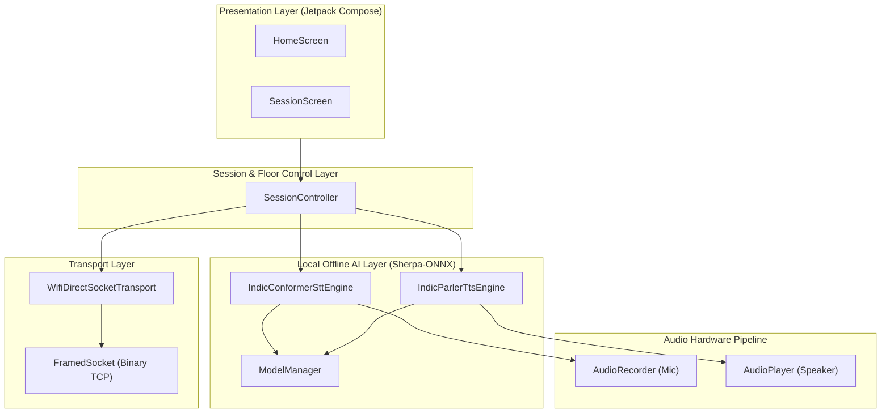

# 📱 iTantra — Complete Technical Architecture & System Specification

## 1. Executive Summary
**iTantra** is a 100% offline, peer-to-peer voice and text communication platform built for Android. It operates entirely without internet connectivity, cellular networks, or cloud infrastructure, leveraging **Wi-Fi Direct (Wi-Fi P2P)** for local networking and **Sherpa-ONNX neural models** for on-device Speech-to-Text (STT) and Text-to-Speech (TTS) processing.

---

## 2. System Architecture Overview

---

## 3. Core Component Specifications

### 🛜 3.1 Network & Transport Layer (`com.itantra.transport`)
- **Transport Mechanism**: Wi-Fi Direct (`WifiP2pManager`) forming a P2P Group (Group Owner + Client).
- **Socket Protocol**: `FramedSocket` running over TCP Port `8988`.
- **Binary Framing Specification**:
  - `FrameType.JSON_PAYLOAD (0x01)`: Control messages (`SESSION_INIT`, `REQUEST_FLOOR`, `RELEASE_FLOOR`), alerts, and transcribed text.
  - `FrameType.RAW_PCM (0x02)`: Uncompressed 16kHz Float32 PCM audio chunks for full-duplex Phone Mode.

### 🎙️ 3.2 Session & Floor Controller (`com.itantra.session`)
- **Language Lock & Handshake**: On connection, devices execute a `SESSION_INIT` exchange validating matching languages.
- **Half-Duplex Floor Control (PTT Mode)**: Manages floor request/grant/release state transitions (`IDLE`, `WAITING_FOR_CHANNEL`, `LOCAL_TRANSMITTING`, `REMOTE_TRANSMITTING`, `CHANNEL_BUSY`).
- **Full-Duplex Phone Mode**: Bypasses AI inference to stream bidirectional raw PCM audio with sub-100ms latency.

### 🤖 3.3 AI Model & Memory Manager (`com.itantra.model`)
- **Engine**: Sherpa-ONNX Runtime (CPU execution provider).
- **Thread Safety**: Mutex-protected model loading/unloading (`sttMutex`, `ttsMutex`) with reference-counted inference locks (`acquireSttForInference` / `releaseSttForInference`) to prevent native C++ segfaults.
- **Dynamic Pre-download**: User-initiated downloading of Indic language models (`hi`, `ta`, `te`, etc.) stored in local app storage.

### 🔊 3.4 Hardware Audio Engine (`com.itantra.audio`)
- **Audio Capture (`AudioRecorder`)**: 16,000 Hz sample rate, 16-bit Mono PCM.
- **Audio Playback (`AudioPlayer`)**: Android `AudioTrack` supporting both single-shot float PCM synthesis playback and continuous stream writing.

---

## 4. Key Operational Flow Protocols

### 4.1 Walkie-Talkie (PTT) Protocol Sequence
1. **User Action**: Press & hold "Hold to Talk".
2. **Floor Request**: `SessionController` transmits `REQUEST_FLOOR`. Peer returns `FLOOR_GRANTED`.
3. **Capture**: `AudioRecorder` buffers microphone input into memory.
4. **Release**: User releases button. `AudioRecorder` stops.
5. **Inference**: `IndicConformerSttEngine` executes local ONNX STT decoding on recorded buffer.
6. **Transmission**: Transcribed text payload is sent via TCP frame.
7. **Synthesis & Output**: Remote peer receives text payload, `IndicParlerTtsEngine` generates VITS audio, and `AudioPlayer` plays it via speaker.

### 4.2 Call (Phone Mode) Protocol Sequence
1. **Mode Switch**: User selects Call Mode (`SessionMode.PHONE`).
2. **Bypass AI**: STT and TTS engines are disarmed to save CPU/RAM.
3. **Continuous Streaming**: `AudioRecorder` captures PCM frames continuously and sends `FrameType.RAW_PCM` TCP frames.
4. **Direct Playback**: Remote peer catches PCM frames and feeds them straight into `AudioPlayer.writeStream()`.

---

## 5. Security & Robustness Highlights
- **100% Offline Air-Gapped Operation**: No data ever leaves the local Wi-Fi Direct network.
- **Resource Protection**: Dynamic memory unloading prevents memory overflow on mid-range Android hardware.
- **Automated Socket Recovery**: Connection drops automatically trigger group cleanup (`removeGroup` / `cancelConnect`) for seamless re-pairing.
