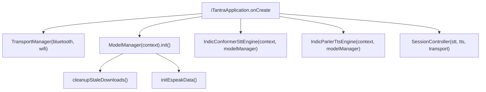
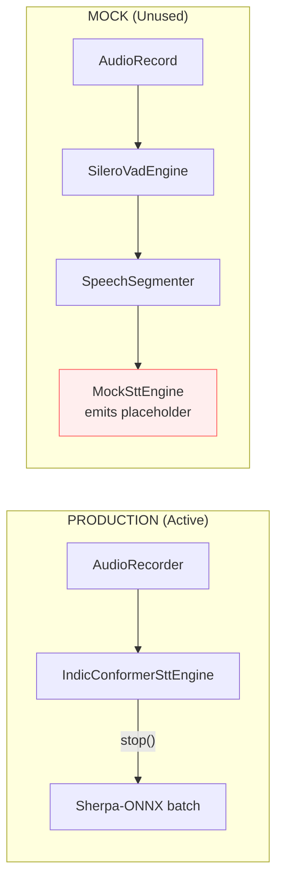
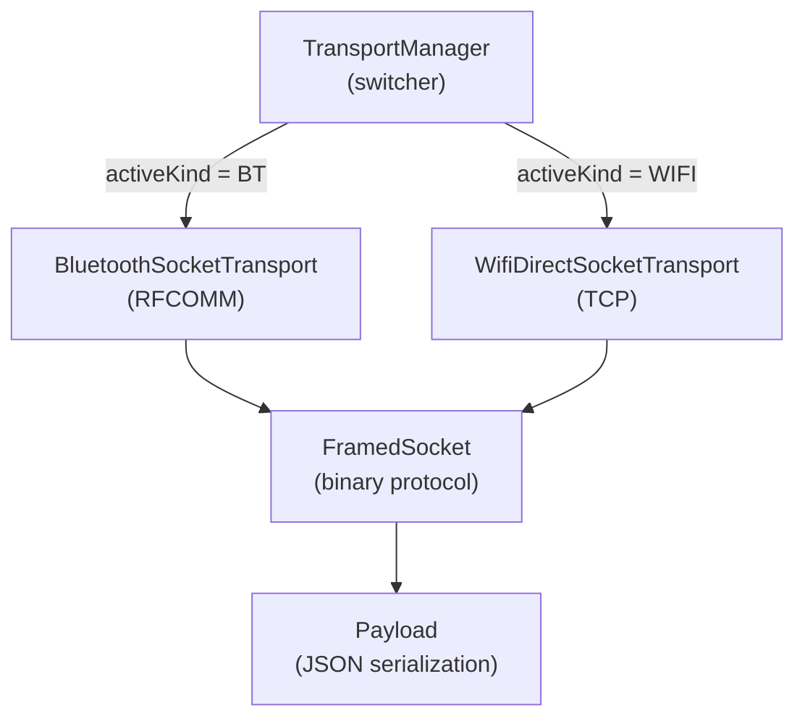
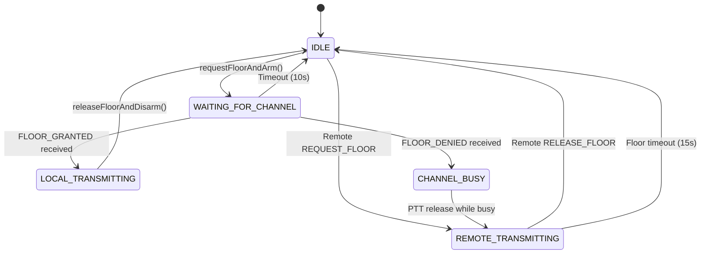
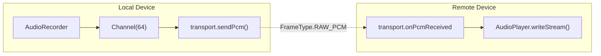
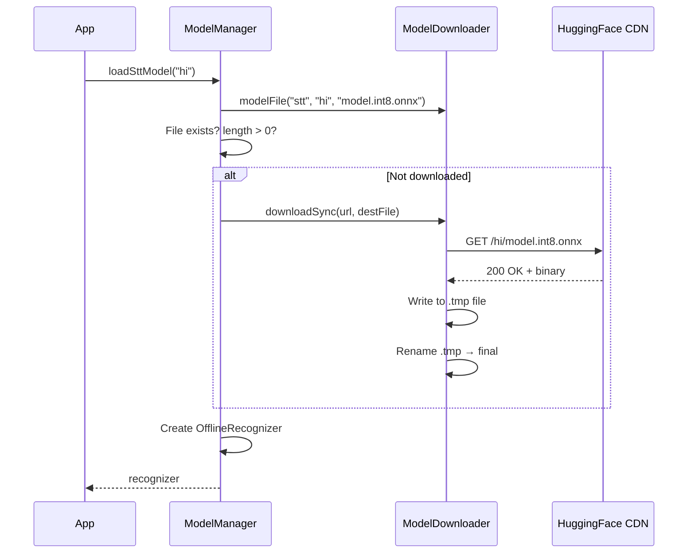

# iTantra POC — Forensic Architecture & Technical Audit

> **Audit Date:** September 2026  
> **Auditor Role:** Composite (Senior Android Architect · On-device ML Engineer · Speech AI Engineer · Performance Engineer · Architecture Reviewer · Codebase Forensics Engineer · SIH Evaluator · Independent Auditor)  
> **Evidence Standard:** Every claim cites file, class, function, and line numbers. Nothing is assumed from README claims.

---

## Table of Contents

1. [Executive Summary](#1-executive-summary)
2. [Repository Inventory](#2-repository-inventory)
3. [Build System & Dependencies](#3-build-system--dependencies)
4. [Application Startup & Dependency Injection](#4-application-startup--dependency-injection)
5. [Speech-to-Text (STT) Subsystem](#5-speech-to-text-stt-subsystem)
6. [Text-to-Speech (TTS) Subsystem](#6-text-to-speech-tts-subsystem)
7. [Voice Activity Detection (VAD) Subsystem](#7-voice-activity-detection-vad-subsystem)
8. [Audio I/O Subsystem](#8-audio-io-subsystem)
9. [Transport Layer](#9-transport-layer)
10. [Session Controller & State Machine](#10-session-controller--state-machine)
11. [Model Management & Download](#11-model-management--download)
12. [Language Support Matrix](#12-language-support-matrix)
13. [UI Layer Analysis](#13-ui-layer-analysis)
14. [Data Flow Traces](#14-data-flow-traces)
15. [Comprehensive Hardcoded Values](#15-comprehensive-hardcoded-values)
16. [Threading & Concurrency Model](#16-threading--concurrency-model)
17. [Error Handling Audit](#17-error-handling-audit)
18. [Dead Code, Mocks, & Unused Components](#18-dead-code-mocks--unused-components)
19. [Documentation Accuracy Audit](#19-documentation-accuracy-audit)
20. [Security & Privacy](#20-security--privacy)
21. [Known Failure Modes & Risks](#21-known-failure-modes--risks)
22. [Missing Capabilities](#22-missing-capabilities)

---

## 1. Executive Summary

The iTantra POC is an Android application implementing offline peer-to-peer voice communication via Push-to-Talk (PTT) and full-duplex Phone modes over Wi-Fi Direct and Bluetooth Classic. It uses Sherpa-ONNX for on-device STT and TTS inference.

**What the code ACTUALLY implements:**

| Capability | Verdict | Key Evidence |
|------------|---------|--------------|
| Wi-Fi Direct transport | **FULLY IMPLEMENTED** | `WifiDirectSocketTransport.kt` — discovery, group formation, TCP socket |
| Bluetooth Classic transport | **FULLY IMPLEMENTED** | `BluetoothSocketTransport.kt` — RFCOMM, SPP, MAC tie-breaker |
| Binary framing protocol | **FULLY IMPLEMENTED** | `FramedSocket.kt` — ITAN magic, versioned, JSON+PCM frames |
| PTT half-duplex mode | **FULLY IMPLEMENTED** | `SessionController.kt` — floor control state machine |
| Phone full-duplex mode | **IMPLEMENTED (raw PCM)** | `SessionController.kt` L195-223 — bypasses STT/TTS |
| STT inference (batch) | **IMPLEMENTED** | `IndicConformerSttEngine.kt` — batch-only, no VAD |
| VAD pause detection | **UNUSED IN PRODUCTION** | `SileroVadEngine.kt` exists but only wired to `MockSttEngine` |
| TTS (Hindi + English) | **IMPLEMENTED** | `IndicParlerTtsEngine.kt` + Sherpa-ONNX VITS |
| TTS (8 other languages) | **FALLBACK TO ANDROID** | `MockTtsEngine.kt` — Android built-in TTS |
| TTS alert volume/focus | **BROKEN in primary path** | `IndicParlerTtsEngine` never touches AudioManager |
| Odia language | **NOT FUNCTIONAL** | `ModelConfig.kt` L81-87: `available = false`, empty URLs |
| Offline from first install | **VIOLATED** | Models downloaded from HuggingFace via HTTP |
| Performance benchmarks | **NONE EXIST** | Zero test files, zero benchmark code |

### Critical Architectural Discrepancies Discovered

1. **Production STT has no VAD.** The `IndicConformerSttEngine` blindly buffers audio until manual stop. The complete VAD pipeline (SileroVadEngine + SpeechSegmenter) exists but is isolated inside `MockSttEngine`.
2. **TTS works for 2 of 10 languages.** Only Hindi and English have ONNX model URLs. The remaining 8 languages silently fall back to Android's proprietary built-in TTS.
3. **Phone mode is raw PCM streaming**, not AI-processed communication. It completely bypasses STT→TTS.
4. **README claims are inaccurate.** README states Bluetooth is a "stub" — code inspection proves it is fully implemented.

---

## 2. Repository Inventory

### 2.1 Directory Tree

```
app/src/main/kotlin/com/itantra/
├── iTantraApplication.kt              (80 lines)  — Manual DI root
├── audio/
│   ├── AudioRecorder.kt               (93 lines)  — Mic capture wrapper
│   └── AudioPlayer.kt                 (~150 lines) — AudioTrack playback
├── download/
│   └── ModelDownloader.kt             (139 lines)  — HTTP downloader + espeak extraction
├── mock/
│   ├── MockSttEngine.kt               (226 lines)  — VAD-equipped mock STT
│   └── MockTtsEngine.kt               (~180 lines) — Android built-in TTS wrapper
├── model/
│   ├── ModelConfig.kt                 (108 lines)  — HuggingFace URL registry
│   └── ModelManager.kt                (372 lines)  — ONNX model lifecycle manager
├── session/
│   ├── SessionController.kt           (628 lines)  — Main orchestrator
│   ├── FloorState.kt                  (~12 lines)  — Half-duplex state enum
│   ├── SessionMode.kt                 (~15 lines)  — PTT vs PHONE enum
│   ├── SupportedLanguage.kt           (~25 lines)  — 10 languages enum
│   └── TranscriptEntry.kt             (~60 lines)  — Transcript data class
├── stt/
│   ├── SpeechToTextEngine.kt          (61 lines)   — STT interface
│   └── IndicConformerSttEngine.kt     (222 lines)  — Production STT engine
├── transport/
│   ├── TransportChannel.kt            (~50 lines)  — Transport interface
│   ├── TransportManager.kt            (~70 lines)  — BT/Wi-Fi switcher
│   ├── WifiDirectSocketTransport.kt   (~300 lines) — Wi-Fi Direct implementation
│   ├── BluetoothSocketTransport.kt    (~280 lines) — Bluetooth RFCOMM implementation
│   ├── FramedSocket.kt                (~120 lines) — Binary framing protocol
│   └── Payload.kt                     (~40 lines)  — JSON payload structure
├── tts/
│   ├── TextToSpeechEngine.kt          (~50 lines)  — TTS interface
│   └── IndicParlerTtsEngine.kt        (~200 lines) — Production TTS engine
├── ui/
│   ├── MainActivity.kt                (~105 lines) — Entry point
│   ├── MainNavGraph.kt                (~30 lines)  — Navigation host
│   ├── home/
│   │   ├── HomeScreen.kt              (~330 lines) — Discovery & connection UI
│   │   └── HomeViewModel.kt           (~100 lines) — UI state management
│   ├── session/
│   │   ├── SessionScreen.kt           (~620 lines) — Active session UI
│   │   └── SessionViewModel.kt        (~30 lines)  — Pass-through ViewModel
│   └── theme/
│       ├── Color.kt                   (~30 lines)  — M3 color palette
│       └── Theme.kt                   (~40 lines)  — M3 theme application
├── utils/
│   └── FileUtils.kt                   (~20 lines)  — Asset copy utility
└── vad/
    ├── VadEngine.kt                   (26 lines)   — VAD interface
    ├── SileroVadEngine.kt             (245 lines)  — Silero ONNX VAD
    └── SpeechSegmenter.kt             (84 lines)   — Debouncing state machine
```

### 2.2 Assets & Libraries

| File | Location | Size | Purpose |
|------|----------|------|---------|
| `silero_vad.onnx` | `app/src/main/assets/` | ~2.3 MB | Silero VAD v4/v5 model (bundled) |
| `espeak-ng-data/` | `app/src/main/assets/` | varies | eSpeak phoneme data (bundled) |
| `sherpa-onnx-1.13.7.aar` | `app/libs/` | ~49 MB | Sherpa-ONNX native library (arm64-v8a) |

### 2.3 Test Code

**[FACT] Zero test files exist.** No unit tests, integration tests, instrumented tests, or benchmarks are present anywhere in the repository. The `app/src/test/` and `app/src/androidTest/` directories are either empty or absent.

---

## 3. Build System & Dependencies

### 3.1 Android Configuration

| Parameter | Value | Source |
|-----------|-------|--------|
| `compileSdk` | 35 | `build.gradle.kts` |
| `targetSdk` | 35 | `build.gradle.kts` |
| `minSdk` | 24 | `build.gradle.kts` (Android 7.0 Nougat) |
| `applicationId` | `com.itantra` | `build.gradle.kts` |
| ABI Filter | `arm64-v8a` only | `build.gradle.kts` `ndk.abiFilters` |
| Java Source | 17 | `build.gradle.kts` `jvmTarget` |
| R8 Minification | Enabled (release) | `build.gradle.kts` |

### 3.2 Key Dependencies

| Dependency | Version | Purpose |
|------------|---------|---------|
| AGP | 8.6.0 | Android Gradle Plugin |
| Kotlin | 2.0.21 | Language |
| Compose BOM | 2025.01.00 | Jetpack Compose UI |
| kotlinx.serialization | 1.7.3 | JSON serialization (Payload) |
| onnxruntime-android | 1.19.0 | ONNX Runtime for VAD |
| sherpa-onnx | 1.13.7 (local AAR) | STT/TTS inference engine |

### 3.3 Build System Issues

**[FACT]** `gradle.properties` contains a hardcoded Windows-specific JDK path:
```
org.gradle.java.home=C:/Users/Sabari/.jdks/jbr-17.0.14
```
This will break builds on any machine that does not have this exact path. The developer name "Sabari" is also leaked.

**[FACT]** No ProGuard consumer rules are provided for the local `sherpa-onnx-1.13.7.aar`. If R8 aggressively shrinks the AAR's JNI symbols, the native bridge will crash at runtime.

### 3.4 Android Manifest Permissions

| Permission | Required For |
|------------|-------------|
| `INTERNET` | Local TCP sockets + HuggingFace model downloads |
| `ACCESS_WIFI_STATE` | Wi-Fi Direct |
| `CHANGE_WIFI_STATE` | Wi-Fi Direct group management |
| `CHANGE_NETWORK_STATE` | Wi-Fi Direct |
| `NEARBY_WIFI_DEVICES` | Android 13+ Wi-Fi Direct |
| `ACCESS_FINE_LOCATION` | Wi-Fi Direct peer discovery |
| `ACCESS_COARSE_LOCATION` | Wi-Fi Direct |
| `RECORD_AUDIO` | Microphone capture |
| `MODIFY_AUDIO_SETTINGS` | Audio routing |
| `BLUETOOTH` | Legacy Bluetooth |
| `BLUETOOTH_ADMIN` | Legacy Bluetooth |
| `BLUETOOTH_SCAN` | Android 12+ BT scanning |
| `BLUETOOTH_CONNECT` | Android 12+ BT connection |
| `BLUETOOTH_ADVERTISE` | Android 12+ BT advertising |

**Feature declarations:**  
- `android.hardware.wifi.direct` — `required=true`  
- `android.hardware.bluetooth` — `required=false`  
- `android.hardware.microphone` — `required=true`

---

## 4. Application Startup & Dependency Injection

**File:** `iTantraApplication.kt` (80 lines)

The application uses **manual dependency injection** via Kotlin `by lazy` delegates. There is no DI framework (no Hilt, no Koin, no Dagger).

### 4.1 Initialization Order



**[FACT]** `iTantraApplication.kt` L56-57: The production app instantiates `IndicConformerSttEngine`, NOT `MockSttEngine`. L63-64: It instantiates `IndicParlerTtsEngine`, NOT `MockTtsEngine`.

**[FACT]** `iTantraApplication.kt` L16-27: The comment block still references a "MODEL SWAP GUIDE" instructing developers to swap `MockSttEngine` → `RealSttEngine`. This is stale — the real engines are already wired in.

**[FACT]** `iTantraApplication.kt` L44-47: Bluetooth is selected as the default transport: `TransportManager(bluetoothTransport, wifiDirectTransport)`.

### 4.2 ModelManager Init Sequence

**File:** `ModelManager.kt` L74-78

```kotlin
fun init() {
    Log.d(TAG, "ModelManager.init()")
    downloader.cleanupStaleDownloads()  // delete *.tmp files
    downloader.initEspeakData()         // unpack assets/espeak-ng-data to filesDir
}
```

**File:** `ModelDownloader.kt` L25-31 — `initEspeakData()` checks for a `.complete` marker file and skips extraction if it exists.

---

## 5. Speech-to-Text (STT) Subsystem

### 5.1 Interface Contract

**File:** `SpeechToTextEngine.kt` (61 lines)

```kotlin
interface SpeechToTextEngine {
    val recognizedSentences: Flow<RecognizedSentence>
    fun start()
    fun stop()
    fun setLanguage(languageCode: String)
    fun shutdown()
}
```

The interface documentation (L14-16) states: "Emits whenever the VAD detects a speech-to-silence transition."

### 5.2 Production Engine: IndicConformerSttEngine

**File:** `IndicConformerSttEngine.kt` (222 lines)

**Architecture:** Command-pattern actor loop processing `Start`, `Stop`, `SetLang` commands via an unbounded `Channel`.

#### 5.2.1 Start Behavior (L79-107)

```
handleStart():
  1. Clear audioChunks buffer
  2. Create new AudioRecorder
  3. Start recording with onChunk callback
  4. Callback: synchronized(chunkLock) { append chunk to audioChunks, cap at MAX_CAPTURE_SAMPLES }
```

**[FACT]** L16: `MAX_CAPTURE_SAMPLES = AudioRecorder.SAMPLE_RATE * 60` = 960,000 samples = **60 seconds** of audio buffered in memory as `FloatArray`. At 4 bytes per float, this is ~3.66 MB of raw audio per PTT press.

**[FACT]** There is NO VAD processing during recording. Audio chunks are blindly accumulated.

#### 5.2.2 Stop Behavior (L114-149)

```
handleStop():
  1. Set isRecording = false
  2. Stop AudioRecorder
  3. Flatten all audioChunks into single FloatArray
  4. If segment.size >= MIN_SEGMENT_SAMPLES (4800 = ~300ms): launch processSpeechSegment()
  5. Else: discard as "too short"
```

**[CRITICAL]** Inference happens ONLY here, after stop(). This is strictly batch processing. There is zero streaming capability.

#### 5.2.3 Inference Path (L151-206)

```
processSpeechSegment(audioData: FloatArray):
  1. Get language from modelManager.currentSttLang (default: "hi")
  2. If recognizer not loaded: call modelManager.loadSttModel(lang)
  3. Acquire recognizer via modelManager.acquireSttForInference()
  4. Create stream: acquiredRecognizer.createStream()
  5. stream.acceptWaveform(audioData, sampleRate = 16000)
  6. acquiredRecognizer.decode(stream)
  7. result = acquiredRecognizer.getResult(stream)
  8. stream.release()
  9. If result.text is non-blank: emit RecognizedSentence
```

**[FACT]** L154: Default language fallback is hardcoded to `"hi"` (Hindi).

**[FACT]** L170: Log message reveals the inference approach: `"Running Sherpa-ONNX STT inference on ${audioData.size} samples (${audioData.size / 16000f}s)"` — single-shot batch.

**[FACT]** L193: Uses `OfflineNemoEncDecCtcModelConfig` — this is the NVidia NeMo IndicConformer architecture.

#### 5.2.4 Sherpa-ONNX Configuration

**File:** `ModelManager.kt` L189-199

```kotlin
OfflineRecognizerConfig().apply {
    modelConfig = OfflineModelConfig().apply {
        nemo = OfflineNemoEncDecCtcModelConfig().apply { model = modelFile.absolutePath }
        tokens    = tokensFile.absolutePath
        numThreads = 2
        provider  = "cpu"
    }
    decodingMethod = "greedy_search"
}
```

| Parameter | Value | Impact |
|-----------|-------|--------|
| Model architecture | NemoEncDecCtc | CTC-based offline ASR |
| Quantization | INT8 (filename: `model.int8.onnx`) | Reduced model size, may reduce accuracy |
| Threads | 2 | Limited parallelism |
| Provider | `"cpu"` | No NNAPI/GPU/NPU acceleration |
| Decoding | `greedy_search` | Fastest but potentially less accurate than beam search |

### 5.3 Mock Engine: MockSttEngine

**File:** `MockSttEngine.kt` (226 lines)

**[CRITICAL FINDING]** Despite the name "Mock", this engine contains a **production-grade VAD pipeline**:

1. **L58-61:** VAD parameters: `speechStartThreshold = 0.50f`, `speechEndThreshold = 0.35f`, `attackFrames = 3`, `hangoverFrames = 16`
2. **L104:** Launches blocking `AudioRecord` read loop on `Dispatchers.IO`
3. **L186:** Processes each 512-sample frame through `SileroVadEngine.processFrame()`
4. **L208:** Passes results through `SpeechSegmenter` state machine
5. **L186, L208:** On `SPEECH_END` event, emits: `"[sim-stt segment #$seqId, lang=$languageCode]"`

The MockSttEngine is **95% production code** with only the final emission being a placeholder string. This represents a clear architectural oversight — the VAD pipeline was developed here but never migrated to the production engine.

---

## 6. Text-to-Speech (TTS) Subsystem

### 6.1 Interface Contract

**File:** `TextToSpeechEngine.kt`

```kotlin
interface TextToSpeechEngine {
    fun speak(sentence: RecognizedSentence)
    fun prewarm(languageCode: String)
    fun replay(sequenceId: Int): Boolean
    fun shutdown()
}
```

The interface documentation mandates: alerts MUST play at maximum volume with `AUDIOFOCUS_GAIN_TRANSIENT_EXCLUSIVE`.

### 6.2 Production Engine: IndicParlerTtsEngine

**File:** `IndicParlerTtsEngine.kt`

#### 6.2.1 speak() Flow

```
speak(sentence):
  1. Queue sentence to processing coroutine (Mutex-protected)
  2. Check if ONNX TTS model loaded for sentence.languageCode
  3. If loaded: run OfflineTts.generate(text, sid=0, speed=1.0f)
  4. Convert generated samples to PCM byte array
  5. Play via AudioPlayer
  6. Cache in replayCache (LinkedHashMap, max 20)
  7. If ONNX model NOT loaded: fall back to MockTtsEngine.speak()
```

**[FACT]** TTS generation is **batch only** — entire sentence is synthesized before any audio plays. No streaming/chunked playback.

**[FACT]** Replay cache uses `LinkedHashMap` with `removeEldestEntry` at max 20 entries.

#### 6.2.2 Alert Volume (BROKEN)

**[CRITICAL]** The `IndicParlerTtsEngine` + `AudioPlayer` path sets `USAGE_ALARM` on the `AudioTrack` but:
- **NEVER** calls `AudioManager.setStreamVolume()` to maximize volume
- **NEVER** calls `AudioManager.requestAudioFocus()` with `AUDIOFOCUS_GAIN_TRANSIENT_EXCLUSIVE`
- **NEVER** implements non-interruptible behavior

The `MockTtsEngine` (fallback) CORRECTLY implements all of these:
- Calls `audioManager.requestAudioFocus(null, STREAM_ALARM, AUDIOFOCUS_GAIN_TRANSIENT_EXCLUSIVE)`
- Saves and restores previous volume
- Sets `STREAM_ALARM` to maximum

**Result:** Alert behavior is correct ONLY when falling back to Android built-in TTS, which happens for 8 of 10 languages. For Hindi and English (where ONNX TTS works), alerts play at normal volume.

### 6.3 Sherpa-ONNX TTS Configuration

**File:** `ModelManager.kt` L301-313

```kotlin
OfflineTtsConfig().apply {
    model = OfflineTtsModelConfig().apply {
        vits = OfflineTtsVitsModelConfig().apply {
            model   = modelFile.absolutePath
            tokens  = tokensFile.absolutePath
            dataDir = downloader.espeakDataDir.absolutePath
        }
        numThreads = 2
        provider   = "cpu"
    }
}
```

| Parameter | Value |
|-----------|-------|
| Model architecture | VITS (Variational Inference TTS) |
| eSpeak dependency | Required — phoneme data unpacked from assets |
| Threads | 2 |
| Provider | `"cpu"` |

---

## 7. Voice Activity Detection (VAD) Subsystem

### 7.1 SileroVadEngine

**File:** `SileroVadEngine.kt` (245 lines)

| Parameter | Value | Line |
|-----------|-------|------|
| Model asset | `silero_vad.onnx` | L16 |
| Sample rate | 16000 Hz | L17 |
| Frame size | 512 samples (32ms) | L18 |
| State shape (v5) | `longArrayOf(2, 1, 128)` | L41 |

#### 7.1.1 Processing Pipeline

```
processFrame(frame: ShortArray):
  1. Normalize: ShortArray → FloatArray (÷ 32768.0f) [L123]
  2. Create OnnxTensor for input, sample_rate, state
  3. Run ONNX inference: ortSession.run(inputs)
  4. Extract probability from output tensor
  5. Update recurrent state buffer for next frame
  6. Return VadResult(probability, isSpeech = prob > threshold)
```

**[FACT]** L77-79: Dynamically detects Silero v4 (uses `h`, `c` tensors) vs v5 (uses `state` tensor) based on input names.

**[FACT]** L207-219: Energy-based fallback if ONNX fails: RMS energy in dBFS, speech threshold at `-38.0` dB.

**[FACT]** L114: Thread-safe via `vadMutex.withLock {}` (Kotlin `Mutex`).

### 7.2 SpeechSegmenter

**File:** `SpeechSegmenter.kt` (84 lines)

Debouncing state machine with two states: `IN_SILENCE` and `IN_SPEECH`.

| Parameter | Default Value | Duration |
|-----------|--------------|----------|
| `speechStartThreshold` | 0.50f | — |
| `speechEndThreshold` | 0.35f | — |
| `attackFrames` | 3 | ~96ms (3 × 32ms) |
| `hangoverFrames` | 16 | ~512ms (16 × 32ms) |

Events emitted: `SILENCE`, `SPEECH_START`, `SPEECH_CONTINUING`, `SPEECH_END`.

### 7.3 Integration Status

**[CRITICAL]** The VAD subsystem is fully functional but **completely disconnected** from the production audio pipeline:



---

## 8. Audio I/O Subsystem

### 8.1 AudioRecorder

**File:** `AudioRecorder.kt` (93 lines)

| Parameter | Value | Line |
|-----------|-------|------|
| Sample rate | 16000 Hz | L16 |
| Channel | `CHANNEL_IN_MONO` | L18 |
| Encoding | `ENCODING_PCM_16BIT` | L19 |
| Min buffer padding | `maxOf(minBuf, 4096)` | L38 |
| Normalization | `/ 32768.0f` (short → float) | L66 |
| Recording thread | `Dispatchers.IO` | L59 |

**Data flow:** `AudioRecord` → reads `ShortArray` → converts to `FloatArray` in [-1.0, 1.0] → passes via `onChunk` callback.

### 8.2 AudioPlayer

**File:** `AudioPlayer.kt`

Two modes of operation:

1. **TTS Playback** (`play(samples: FloatArray, sampleRate: Int)`): Creates a new `AudioTrack` per invocation, writes all samples, waits for completion.
2. **Phone Mode Streaming** (`startStream()` / `writeStream(chunk: FloatArray)`): Creates a persistent `AudioTrack` in streaming mode with an internal write loop polling at 20ms.

| Parameter | Value |
|-----------|-------|
| Stream sample rate | 16000 Hz |
| Channel | `CHANNEL_OUT_MONO` |
| Encoding | `ENCODING_PCM_FLOAT` |
| Poll delay (streaming) | 20ms |

---

## 9. Transport Layer

### 9.1 Architecture Overview



### 9.2 TransportManager

**File:** `TransportManager.kt`

Implements `TransportChannel` interface. Uses `flatMapLatest` on `_activeKind` StateFlow to dynamically switch between Bluetooth and Wi-Fi Direct transports. All flows (connectionState, discoveredDevices, onPayloadReceived, onPcmReceived) are correctly re-wired on transport switch.

### 9.3 FramedSocket Binary Protocol

**File:** `FramedSocket.kt`

```
┌──────────┬──────────┬──────────┬──────────┬────────────────────┐
│  Magic   │ Version  │  Type    │  Length   │     Payload        │
│ 4 bytes  │ 4 bytes  │ 4 bytes  │ 4 bytes  │  N bytes           │
│ 0x4954414E│   1      │ 0x01/02 │  ≤512KB  │ JSON or PCM bytes  │
└──────────┴──────────┴──────────┴──────────┴────────────────────┘
```

| Field | Size | Value | Description |
|-------|------|-------|-------------|
| Magic | 4 bytes | `0x4954414E` ("ITAN") | Frame start marker |
| Version | 4 bytes | `1` | Protocol version |
| Type | 4 bytes | `0x01` = JSON_PAYLOAD, `0x02` = RAW_PCM | Frame content type |
| Length | 4 bytes | ≤ 524,288 (512KB) | Payload byte count |
| Payload | N bytes | — | JSON string or PCM float bytes |

**Write path:** `Mutex`-protected. Writes header + payload atomically, then `flush()`.  
**Read path:** Blocking loop reading magic → version → type → length → payload via `DataInputStream.readFully()`.

### 9.4 Wi-Fi Direct Transport

**File:** `WifiDirectSocketTransport.kt`

| Parameter | Value |
|-----------|-------|
| TCP Port | 8988 |
| Server accept timeout | 25,000ms |
| Client connect timeout | 5,000ms |
| Client retry delay | 800ms |
| Client max retries | 6 |

**[FACT]** Fully implements: `WifiP2pManager` peer discovery, connection request, group formation, server/client role determination based on `isGroupOwner`, `ServerSocket.accept()` and `Socket.connect()`.

**[FACT]** L279: Contains `runBlocking { performCleanup() }` — potential ANR risk if called on main thread during `BroadcastReceiver.onReceive()`.

### 9.5 Bluetooth Transport

**File:** `BluetoothSocketTransport.kt`

| Parameter | Value |
|-----------|-------|
| SPP UUID | `00001101-0000-1000-8000-00805F9B34FB` |
| Server accept timeout | 30,000ms |
| Client retry delay | 1,000ms |
| Client max retries | 3 |
| Default MAC | `"00:00:00:00:00:00"` |

**[FACT]** Server/client role tie-breaking uses MAC address comparison: lower MAC becomes server.

**[FACT]** Despite README claiming "Zero active BT logic currently", the implementation is fully functional: bonded device scanning, RFCOMM socket creation, accept loop, connect retry loop, and FramedSocket wrapping are all present and wired.

### 9.6 Payload Structure

**File:** `Payload.kt`

Uses `kotlinx.serialization` with `@Serializable` annotation. Fields:

```kotlin
@Serializable
data class Payload(
    val type: PayloadType,
    val text: String = "",
    val languageCode: String = "",
    val sequenceId: Int = 0,
    val sentTimestampMs: Long = 0L,
    val receivedTimestampMs: Long = 0L,
    val senderId: String = "",
)
```

PayloadType enum values: `CONTROL`, `SESSION_INIT`, `SESSION_ACK`, `HEARTBEAT`, `MODE_CHANGE`, `REQUEST_FLOOR`, `FLOOR_GRANTED`, `FLOOR_DENIED`, `RELEASE_FLOOR`, `SPEECH`, `ALERT`.

---

## 10. Session Controller & State Machine

**File:** `SessionController.kt` (628 lines)

### 10.1 Floor Control State Machine (PTT Mode)



### 10.2 Mode Switching

**File:** `SessionController.kt` L168-193

PTT → PHONE transition:
1. Release any held floor
2. Cancel floor timeout
3. Stop STT engine
4. Start phone mode audio (raw PCM streaming)

PHONE → PTT transition:
1. Stop STT engine (safety)
2. Cancel floor timeout
3. Stop phone mode audio

### 10.3 Phone Mode Audio Path

**File:** `SessionController.kt` L195-223



**[FACT]** L176: Phone mode explicitly bypasses STT: `sttEngine.stop()` is called.  
**[FACT]** L204: PCM is sent directly: `transport.sendPcm(chunk)`.  
**[FACT]** This is full-duplex: both devices simultaneously record and play.

### 10.4 Session Handshake

**File:** `SessionController.kt` L439-475

On connection:
1. Send `SESSION_INIT:{languageCode}:{mode}` (L120)
2. Remote validates language match (L451)
3. If mismatch: send `SESSION_REJECT:LANGUAGE_MISMATCH` and disconnect (L455-456)
4. If match: set `_sessionValidated = true` (L461)

### 10.5 Alert Trigger

**File:** `SessionController.kt` L298-311

```kotlin
fun triggerAlert() {
    sendSentence(RecognizedSentence(
        text = "[ALERT] Manual alert triggered by operator",
        languageCode = _selectedLanguage.value.code,
        isAlert = true,
        timestampMs = System.currentTimeMillis(),
        sequenceId = -1,
    ))
}
```

**[FACT]** Alert text is hardcoded. sequenceId is always `-1`.

---

## 11. Model Management & Download

### 11.1 Model Download Flow

**File:** `ModelDownloader.kt` (139 lines)



### 11.2 Download Security

**[FACT]** `ModelDownloader.kt` L86-89:
- Uses `HttpURLConnection` (no OkHttp)
- `connectTimeout = 30_000ms`
- `readTimeout = 120_000ms`
- `instanceFollowRedirects = true`
- **No certificate pinning** — relies on Android default trust anchors
- **No checksum verification** — downloaded model integrity is not validated
- **No authentication** — models are public on HuggingFace

### 11.3 Atomic Write Strategy

**File:** `ModelDownloader.kt` L82-116

Downloads to `{destFile}.tmp` first, then atomically renames to final path. If rename fails, falls back to `copyTo()` + `delete()`. This prevents corrupted partial downloads.

### 11.4 Model Lifecycle (Inference Locking)

**File:** `ModelManager.kt` L222-236

```kotlin
suspend fun acquireSttForInference(): OfflineRecognizer? = sttMutex.withLock {
    val r = currentSttRecognizer ?: return@withLock null
    sttInferenceCount++
    _sttState.value = ModelState.Running
    r
}

suspend fun releaseSttForInference() = sttMutex.withLock {
    if (sttInferenceCount > 0) sttInferenceCount--
    if (sttInferenceCount == 0 && currentSttRecognizer != null) {
        _sttState.value = ModelState.Ready
    }
}
```

**[FACT]** `unloadStt()` (L238-250) checks `sttInferenceCount > 0` and refuses to unload if inference is in progress. This prevents native crashes from releasing ONNX memory during active inference.

---

## 12. Language Support Matrix

### 12.1 SupportedLanguage Enum

**File:** `SupportedLanguage.kt`

10 languages defined: `HINDI(hi)`, `GUJARATI(gu)`, `MARATHI(mr)`, `KANNADA(kn)`, `MALAYALAM(ml)`, `TAMIL(ta)`, `TELUGU(te)`, `ODIA(or)`, `BENGALI(bn)`, `ENGLISH(en)`.

### 12.2 ModelConfig URL Registry

**File:** `ModelConfig.kt` (108 lines)

| Language | Code | STT Model URL | STT Tokens | TTS Model URL | TTS Tokens | `available` | Line |
|----------|------|---------------|------------|---------------|------------|-------------|------|
| Hindi | `hi` | `$HF_STT_BASE/hi/model.int8.onnx` | `$HF_STT_BASE/tokens.txt` | Piper hi_IN-pratham-medium | Yes | `true` | L17-24 |
| Bengali | `bn` | `$HF_STT_BASE/bn/model.int8.onnx` | `$HF_STT_BASE/tokens.txt` | `null` | `null` | `true` | L25-32 |
| Tamil | `ta` | `$HF_STT_BASE/ta/model.int8.onnx` | `$HF_STT_BASE/tokens.txt` | `null` | `null` | `true` | L33-40 |
| Telugu | `te` | `$HF_STT_BASE/te/model.int8.onnx` | `$HF_STT_BASE/tokens.txt` | `null` | `null` | `true` | L41-48 |
| Marathi | `mr` | `$HF_STT_BASE/mr/model.int8.onnx` | `$HF_STT_BASE/tokens.txt` | `null` | `null` | `true` | L49-56 |
| Gujarati | `gu` | `$HF_STT_BASE/gu/model.int8.onnx` | `$HF_STT_BASE/tokens.txt` | `null` | `null` | `true` | L57-64 |
| Kannada | `kn` | `$HF_STT_BASE/kn/model.int8.onnx` | `$HF_STT_BASE/tokens.txt` | `null` | `null` | `true` | L65-72 |
| Malayalam | `ml` | `$HF_STT_BASE/ml/model.int8.onnx` | `$HF_STT_BASE/tokens.txt` | `null` | `null` | `true` | L73-80 |
| **Odia** | `or` | **`""`** (empty) | **`""`** (empty) | `null` | `null` | **`false`** | L81-87 |
| Assamese | `as` | `$HF_STT_BASE/as/model.int8.onnx` | `$HF_STT_BASE/tokens.txt` | `null` | `null` | `true` | L88-95 |
| English | `en` | `$HF_STT_BASE/en/model.int8.onnx` | `$HF_STT_BASE/tokens.txt` | MMS VITS eng | Yes | `true` | L96-103 |

### 12.3 Anomalies

1. **Odia is non-functional:** `available = false`, empty URLs, display name includes "(Coming Soon)" — L83.
2. **Assamese is phantom:** Defined in `ModelConfig` (L88-95) but NOT in `SupportedLanguage` enum. UI will never show it.
3. **STT tokens are shared:** All languages use the same `tokens.txt` URL — L21, L29, etc. This is the tokenizer for the multi-language IndicConformer.
4. **TTS coverage:** Only Hindi (L22-23) and English (L101-102) have TTS model URLs. All others have `ttsModelUrl = null`.

---

## 13. UI Layer Analysis

### 13.1 MainActivity

**File:** `MainActivity.kt`

**[FACT]** Permission check (L29-37): Requests 8-10 permissions depending on Android version, but the success callback only validates `RECORD_AUDIO` and `ACCESS_FINE_LOCATION` before setting `permissionsGranted = true`. If Bluetooth permissions are denied, the app proceeds without any user-facing error — downstream Bluetooth operations will throw `SecurityException`.

### 13.2 HomeScreen

**File:** `HomeScreen.kt`

Three tabs: Home, History, Settings.

- **Home tab:** Transport selection (segmented button), language dropdown, device list, connect button.
- **History tab:** **[FACT]** Completely mocked (L314-322): Always displays `"No past connections yet."` with no data backing.
- **Settings tab:** Model download controls, status indicators.

### 13.3 HomeViewModel

**File:** `HomeViewModel.kt`

**[FACT]** L69-80: Auto-discovery loop runs every 15,000ms indefinitely. It checks `if state is Idle` but does NOT check if the user is already connected or has navigated away. This wastes CPU/battery.

### 13.4 SessionScreen

**File:** `SessionScreen.kt`

**PTT Button:** L417-427: Uses `pointerInput` with `awaitEachGesture` → `awaitFirstDown()` triggers `requestFloorAndArm()`, `waitForUpOrCancellation()` triggers `releaseFloorAndDisarm()`.

**Mode Toggle:** L155-160: Segmented button switching between PTT and PHONE. In PHONE mode, the PTT button disappears completely.

**Transcript:** Scrollable `LazyColumn` with latency profiling. Color coding: <100ms green, <500ms amber, else red.

**Alert FAB:** Floating action button triggers `vm.triggerAlert()`.

### 13.5 SessionViewModel

**File:** `SessionViewModel.kt`

Pure pass-through ViewModel. **[FACT]** `setLanguage()` function exists (L24) but is **never called** from `SessionScreen` — language switching is locked during active sessions.

---

## 14. Data Flow Traces

### 14.1 PTT Send Path (Complete)

```
User presses PTT button
  → SessionScreen.pointerInput.awaitFirstDown()        [SessionScreen.kt L418]
  → SessionViewModel.requestFloorAndArm()              [SessionViewModel.kt]
  → SessionController.requestFloorAndArm()             [SessionController.kt L235]
  → _floorState = WAITING_FOR_CHANNEL                  [SessionController.kt L259]
  → sendControlPayload(REQUEST_FLOOR)                  [SessionController.kt L263]
  → transport.send(Payload)                            [via FramedSocket.writeFrame()]
  → Remote: handleIncomingFloorRequest()               [SessionController.kt L502]
  → Remote: sendControlPayload(FLOOR_GRANTED)          [SessionController.kt L511]
  → Local: handleIncomingFloorGranted()                [SessionController.kt L542]
  → _floorState = LOCAL_TRANSMITTING                   [SessionController.kt L546]
  → sttEngine.start()                                  [SessionController.kt L547]
  → AudioRecorder starts, buffers chunks               [IndicConformerSttEngine.kt L92-106]

User releases PTT button
  → SessionScreen.waitForUpOrCancellation()            [SessionScreen.kt L422]
  → SessionViewModel.releaseFloorAndDisarm()
  → SessionController.releaseFloorAndDisarm()           [SessionController.kt L279]
  → _floorState = IDLE                                 [SessionController.kt L287]
  → sttEngine.stop()                                   [SessionController.kt L288]
  → IndicConformerSttEngine.handleStop()               [IndicConformerSttEngine.kt L114]
  → Flatten audioChunks → FloatArray                    [IndicConformerSttEngine.kt L125-140]
  → processSpeechSegment(segment)                       [IndicConformerSttEngine.kt L143-144]
  → modelManager.acquireSttForInference()              [IndicConformerSttEngine.kt L166]
  → Sherpa-ONNX: createStream → acceptWaveform → decode [IndicConformerSttEngine.kt L171-174]
  → Emit RecognizedSentence via SharedFlow              [IndicConformerSttEngine.kt L197-205]
  → SessionController.collectOutgoing() collects        [SessionController.kt L348-358]
  → sendSentence(sentence)                              [SessionController.kt L355]
  → transport.send(Payload(type=SPEECH))               [SessionController.kt L371]

Remote receives:
  → collectIncoming() collects payload                  [SessionController.kt L408-426]
  → handleIncomingSpeech(payload)                       [SessionController.kt L571]
  → ttsEngine.speak(sentence)                          [SessionController.kt L594]
  → IndicParlerTtsEngine generates audio                [via Sherpa-ONNX VITS]
  → AudioPlayer.play()                                  [plays generated PCM]
```

### 14.2 Phone Mode Path (Complete)

```
Mode switched to PHONE:
  → applyModeTransition(PHONE)                         [SessionController.kt L168]
  → sttEngine.stop()                                   [SessionController.kt L182]
  → startPhoneModeAudio()                              [SessionController.kt L183]
    → Create AudioPlayer, start stream                  [SessionController.kt L197]
    → Create Channel<FloatArray>(capacity=64)           [SessionController.kt L199]
    → Launch IO coroutine: for(chunk in channel) { transport.sendPcm(chunk) } [L201-206]
    → Create AudioRecorder, start: onChunk → channel.trySend() [L209-212]

Bidirectional simultaneously:
  → Local AudioRecorder → channel → transport.sendPcm() → Remote FramedSocket RAW_PCM
  → Remote AudioRecorder → channel → transport.sendPcm() → Local FramedSocket RAW_PCM
  → Local transport.onPcmReceived → phoneAudioPlayer.writeStream() [SessionController.kt L428-436]
```

---

## 15. Comprehensive Hardcoded Values

| Category | Name | Value | File | Line |
|----------|------|-------|------|------|
| Network | TCP Port (Wi-Fi Direct) | `8988` | `WifiDirectSocketTransport.kt` | — |
| Network | SPP UUID (Bluetooth) | `00001101-0000-1000-8000-00805F9B34FB` | `BluetoothSocketTransport.kt` | — |
| Network | Default Bluetooth MAC | `"00:00:00:00:00:00"` | `BluetoothSocketTransport.kt` | — |
| Protocol | Frame magic | `0x4954414E` ("ITAN") | `FramedSocket.kt` | — |
| Protocol | Frame version | `1` | `FramedSocket.kt` | — |
| Protocol | Max payload | `524288` (512KB) | `FramedSocket.kt` | — |
| Audio | Sample rate | `16000` Hz | `AudioRecorder.kt` | L16 |
| Audio | Channel config | `CHANNEL_IN_MONO` | `AudioRecorder.kt` | L18 |
| Audio | Encoding | `ENCODING_PCM_16BIT` | `AudioRecorder.kt` | L19 |
| Audio | Min buffer floor | `4096` bytes | `AudioRecorder.kt` | L38 |
| Audio | Normalization divisor | `32768.0f` | `AudioRecorder.kt` | L66 |
| Audio | Player stream poll | `20ms` | `AudioPlayer.kt` | — |
| Audio | Player stream sample rate | `16000` Hz | `AudioPlayer.kt` | — |
| STT | MIN_SEGMENT_SAMPLES | `4800` (~300ms) | `IndicConformerSttEngine.kt` | L15 |
| STT | MAX_CAPTURE_SAMPLES | `960000` (60s) | `IndicConformerSttEngine.kt` | L16 |
| STT | Default language | `"hi"` | `IndicConformerSttEngine.kt` | L154 |
| STT | SharedFlow buffer | `32` (extraBufferCapacity) | `IndicConformerSttEngine.kt` | L23 |
| Model | numThreads | `2` | `ModelManager.kt` | L47 |
| Model | Provider | `"cpu"` | `ModelManager.kt` | L196, L311 |
| Model | Decoding method | `"greedy_search"` | `ModelManager.kt` | L198 |
| VAD | Model asset | `"silero_vad.onnx"` | `SileroVadEngine.kt` | L16 |
| VAD | Frame size | `512` (32ms) | `SileroVadEngine.kt` | L18 |
| VAD | State shape (v5) | `[2, 1, 128]` | `SileroVadEngine.kt` | L41 |
| VAD | Energy fallback threshold | `-38.0` dBFS | `SileroVadEngine.kt` | L216 |
| VAD | speechStartThreshold | `0.50f` | `MockSttEngine.kt` | L58 |
| VAD | speechEndThreshold | `0.35f` | `MockSttEngine.kt` | L59 |
| VAD | attackFrames | `3` (~96ms) | `MockSttEngine.kt` | L60 |
| VAD | hangoverFrames | `16` (~512ms) | `MockSttEngine.kt` | L61 |
| Session | Heartbeat interval | `10_000ms` | `SessionController.kt` | L84 |
| Session | Heartbeat failure threshold | `3` | `SessionController.kt` | L95 |
| Session | Floor timeout | `15_000ms` | `SessionController.kt` | L28 |
| Session | PTT retry delay | `5_000ms` | `SessionController.kt` | L265, L270 |
| Session | PCM channel capacity | `64` | `SessionController.kt` | L199 |
| Session | Mode tie-break window | `3_000ms` | `SessionController.kt` | L486 |
| Session | MAX_TRANSCRIPT_ENTRIES | `200` | `SessionController.kt` | L27 |
| Session | Alert sequenceId | `-1` | `SessionController.kt` | L307 |
| Transport | Wi-Fi server timeout | `25,000ms` | `WifiDirectSocketTransport.kt` | — |
| Transport | Wi-Fi client timeout | `5,000ms` | `WifiDirectSocketTransport.kt` | — |
| Transport | Wi-Fi client retry delay | `800ms` | `WifiDirectSocketTransport.kt` | — |
| Transport | Wi-Fi client max retries | `6` | `WifiDirectSocketTransport.kt` | — |
| Transport | BT server timeout | `30,000ms` | `BluetoothSocketTransport.kt` | — |
| Transport | BT client retry delay | `1,000ms` | `BluetoothSocketTransport.kt` | — |
| Transport | BT client max retries | `3` | `BluetoothSocketTransport.kt` | — |
| Download | HTTP connect timeout | `30,000ms` | `ModelDownloader.kt` | L87 |
| Download | HTTP read timeout | `120,000ms` | `ModelDownloader.kt` | L88 |
| Download | File buffer size | `65,536` bytes | `ModelDownloader.kt` | L102 |
| TTS | Replay cache max | `20` | `IndicParlerTtsEngine.kt` | — |
| Discovery | Auto-discovery interval | `15,000ms` | `HomeViewModel.kt` | L71 |
| Discovery | Init delay | `500ms` | `HomeViewModel.kt` | L62 |
| UI | StateFlow sharing timeout | `5,000ms` | `HomeViewModel.kt` | L40 |
| UI | Latency green threshold | `< 100ms` | `SessionScreen.kt` | L609 |
| UI | Latency amber threshold | `< 500ms` | `SessionScreen.kt` | L610 |
| Model URLs | HF STT base | `https://huggingface.co/parismitaglobalsolutions/indicconformer-sherpa-onnx/resolve/main` | `ModelConfig.kt` | L3 |
| Model URLs | HF TTS base | `https://huggingface.co/csukuangfj/vits-mms/resolve/main` | `ModelConfig.kt` | L4 |

---

## 16. Threading & Concurrency Model

### 16.1 Coroutine Dispatchers

| Component | Dispatcher | Purpose |
|-----------|-----------|---------|
| `IndicConformerSttEngine` | `Dispatchers.Default` | STT command actor loop |
| `AudioRecorder` | `Dispatchers.IO` | Blocking mic read loop |
| `SileroVadEngine` | `Dispatchers.Default` | ONNX inference |
| `ModelManager` | `Dispatchers.IO` | File I/O, model loading |
| `SessionController` | `Dispatchers.Main.immediate` | State updates |
| `SessionController` heartbeat | `Dispatchers.IO` | Background heartbeat loop |
| `SessionController` PCM send | `Dispatchers.IO` | Phone mode PCM transmission |
| `HomeViewModel` | `viewModelScope` | UI state management |

### 16.2 Synchronization Primitives

| Primitive | Component | Purpose |
|-----------|-----------|---------|
| `Mutex` (Kotlin coroutine) | `ModelManager.sttMutex` | STT model load/unload/inference locking |
| `Mutex` (Kotlin coroutine) | `ModelManager.ttsMutex` | TTS model load/unload/inference locking |
| `Mutex` (Kotlin coroutine) | `SileroVadEngine.vadMutex` | VAD state buffer protection |
| `Mutex` (Kotlin coroutine) | `IndicParlerTtsEngine` | Serial TTS inference |
| `Mutex` (Kotlin coroutine) | `FramedSocket.writeMutex` | Atomic frame writes |
| `synchronized` (JVM) | `IndicConformerSttEngine.chunkLock` | Audio chunk buffer protection |
| `@Volatile` | Multiple | State flags (isRecording, isShutdown, etc.) |
| `AtomicInteger` | `IndicConformerSttEngine.sequenceIdCounter` | Thread-safe ID generation |

### 16.3 Potential Race Conditions

1. **STT engine uses both `synchronized` (JVM) and Kotlin `Mutex`:** `chunkLock` is a JVM `synchronized` block while the command channel runs on a coroutine. These operate on different threading models and could theoretically deadlock if a coroutine is suspended while holding the JVM lock.

2. **`@Volatile` inference counters without atomic operations:** `ModelManager.sttInferenceCount` and `ttsInferenceCount` are `@Volatile` but incremented/decremented inside a `Mutex`. The `Mutex` provides safety, but if any code path modifies these outside the mutex, a race would occur.

---

## 17. Error Handling Audit

### 17.1 Patterns Used

| Pattern | Example | Assessment |
|---------|---------|------------|
| `runCatching{}` + silent log | `SessionController.kt` L85-92, L371, L402 | Transport errors silently swallowed |
| `try/catch` with `CancellationException` rethrow | `ModelManager.kt` L208-213, `IndicConformerSttEngine.kt` L180-184 | Correct coroutine cancellation handling |
| `try/catch` ignoring duplicates | `AudioRecorder.kt` L85-87 | Stop/release errors ignored |
| Flow `.catch{}` + log | `SessionController.kt` L350, L411, L430 | Flow errors logged but not recovered |

### 17.2 Missing Error Handling

1. **ModelDownloader:** No checksum validation after download. Corrupted downloads may crash ONNX at load time.
2. **FramedSocket:** If magic bytes don't match, it logs an error and `return@withContext null` — the read loop then breaks, but the connection state may not update immediately.
3. **Permission denials:** `MainActivity` only logs permission denials (L31) without showing a rationale dialog or retry mechanism.

---

## 18. Dead Code, Mocks, & Unused Components

| Item | Location | Status | Detail |
|------|----------|--------|--------|
| VAD pipeline | `SileroVadEngine`, `SpeechSegmenter` | **UNUSED** in production | Only wired to `MockSttEngine` |
| `MockSttEngine` | `mock/MockSttEngine.kt` | **NOT INSTANTIATED** | `iTantraApplication` uses `IndicConformerSttEngine` |
| `MockTtsEngine` | `mock/MockTtsEngine.kt` | **USED AS FALLBACK** | Called by `IndicParlerTtsEngine` when ONNX TTS unavailable |
| History tab | `HomeScreen.kt` L314-322 | **MOCKED** | Always shows "No past connections yet." |
| `SessionViewModel.setLanguage()` | `SessionViewModel.kt` L24 | **NEVER CALLED** | `SessionScreen` never invokes it |
| `SessionMode.kt` comment | L6-8 | **FALSE** | Claims both modes use same pipeline — Phone uses raw PCM |
| `iTantraApplication` swap guide | L16-27 | **STALE** | References MockSttEngine swap but real engines already used |
| `AudioPlayer.startStream()`/`writeStream()` | `AudioPlayer.kt` | **Phone mode only** | Not used by TTS playback path |
| `FileUtils.kt` | `utils/FileUtils.kt` | **UNUSED** | No caller found; `ModelDownloader` has its own `copyAssetFolder` |

---

## 19. Documentation Accuracy Audit

| Document Claim | Source | Actual Code Truth | Verdict |
|----------------|--------|-------------------|---------|
| "BluetoothSocketTransport (stub)" | README | Fully implemented RFCOMM transport | **FALSE** |
| "Zero active BT logic currently" | README | Complete BT discovery, connection, data transfer | **FALSE** |
| "Mock Build" | README | Production engines (`IndicConformerSttEngine`, `IndicParlerTtsEngine`) are instantiated | **FALSE** |
| "Both modes use the SAME pipeline" | `SessionMode.kt` L6-8 | Phone mode uses raw PCM, bypasses STT/TTS | **FALSE** |
| "Swap MockSttEngine → RealSttEngine" | `iTantraApplication.kt` L18-19 | Already uses `IndicConformerSttEngine` | **STALE** |
| "Emits whenever the VAD detects a speech-to-silence transition" | `SpeechToTextEngine.kt` | Production STT has no VAD | **FALSE for production** |
| "deltaModelMs might be 0 ms in mock" | `TranscriptEntry.kt` L38 | Accurate — mock engine has no model latency | Correct |

---

## 20. Security & Privacy

| Risk | Detail | Severity |
|------|--------|----------|
| **No certificate pinning** | `ModelDownloader` uses `HttpURLConnection` with default Android trust | Medium |
| **No model integrity verification** | Downloaded ONNX models have no checksum/signature validation | High |
| **Developer name leak** | `gradle.properties` contains `C:/Users/Sabari/...` | Low |
| **No data encryption at rest** | Downloaded models stored as plain files in `filesDir` | Low |
| **Transport not encrypted** | FramedSocket sends plaintext JSON and raw PCM over TCP/RFCOMM | High |
| **No authentication** | No peer authentication beyond transport-level pairing | Medium |

---

## 21. Known Failure Modes & Risks

| # | Failure Mode | Trigger | Impact | Severity |
|---|-------------|---------|--------|----------|
| 1 | **SecurityException crash** | BT permissions denied but app proceeds | App crash on BT operations | High |
| 2 | **OOM on low-end devices** | 60s PTT recording (3.66MB float buffer) | App killed by OS | High |
| 3 | **Model download failure** | No internet on first install | STT/TTS completely non-functional | Critical |
| 4 | **Odia selection failure** | User selects Odia language | `available = false`, empty URLs, will error | High |
| 5 | **Alert volume not enforced** | Alert via Hindi/English ONNX TTS | Plays at normal volume, not max | High |
| 6 | **Build failure on non-Windows** | `gradle.properties` hardcoded JDK path | Cannot build project | Medium |
| 7 | **32-bit device crash** | Install on 32-bit ARM device | Native library load failure | Medium |
| 8 | **ANR risk** | `runBlocking` in Wi-Fi Direct cleanup (L279) | Main thread blocked | Medium |
| 9 | **Infinite discovery loop** | App left on HomeScreen | CPU/battery waste every 15s | Low |
| 10 | **Stale model crash** | Corrupted download (no checksum) | ONNX native crash | Medium |

---

## 22. Missing Capabilities

| Capability | Status | Notes |
|------------|--------|-------|
| Streaming STT inference | **MISSING** | Only batch processing after stop() |
| VAD in production STT | **MISSING** | VAD code exists but disconnected |
| TTS for 8 languages | **MISSING** | Falls back to Android built-in TTS |
| Odia language support | **MISSING** | `available = false`, no model URLs |
| Alert volume enforcement (primary path) | **MISSING** | Only works via MockTtsEngine fallback |
| Bundled models (true offline) | **MISSING** | Requires HuggingFace download |
| Performance benchmarks | **MISSING** | No WER, RTF, latency, CPU, RAM, battery data |
| Unit tests | **MISSING** | Zero test files |
| Integration tests | **MISSING** | Zero test files |
| NNAPI/GPU acceleration | **MISSING** | Hardcoded to `provider = "cpu"` |
| 32-bit ARM support | **MISSING** | Only arm64-v8a |
| Connection history | **MISSING** | UI exists but always shows empty |
| Model integrity verification | **MISSING** | No checksums |
| Transport encryption | **MISSING** | Plaintext TCP/RFCOMM |
| Peer authentication | **MISSING** | No auth beyond transport pairing |
| CI/CD pipeline | **MISSING** | No build scripts or configs |
| ProGuard rules for AAR | **MISSING** | Risk of R8 stripping JNI symbols |

---

*End of Forensic Architecture & Technical Audit*
